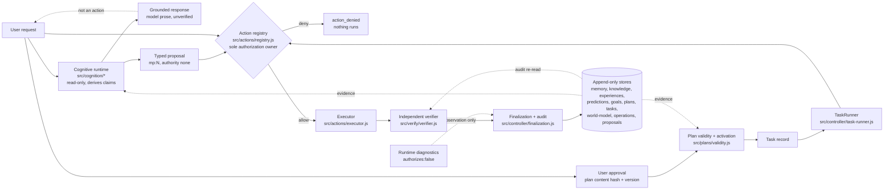

# APEX Local Alpha — consolidated architecture

This document is the single consolidated description of the cognitive runtime and the executive
system as they exist in `apex_app/` after Batch AO-10. It replaces no code and grants nothing. It
was written against commit `cbc34cb` (`ao-09`) plus the AO-10 documentation changes, by reading the
modules and tests named below. Where a statement is a contract enforced by code, the module is
named; where it is a guarantee established by tests, the suite is named; where it is only a
description, it says so.

Three evidence rules apply throughout:

- A passing test is evidence about this code on this platform with a deterministic fixture. It is
  not evidence about a real model, real-world truth, or secure operation in an adversarial
  environment.
- No test in this repository runs a model. Every backend is `NoBackend` or a programmatic stub with
  a fixed reply. The only real-model observations are the dated historical notes in
  [`README.md`](README.md#historical-record-the-controlled-real-model-run-of-2026-10-31).
- Model output, retrieved records, diagnostics, and handoffs are data. None of them authorizes an
  action.

## 1. Status vocabulary used below

| Status | Meaning |
| --- | --- |
| `IMPLEMENTED_AND_TESTED` | Code enforces the behavior, and at least one named test exercises it through a real module or child process. |
| `IMPLEMENTED_PARTIALLY_TESTED` | Code enforces it, but a named boundary has no direct test (for example, no killed child at that instant). |
| `IMPLEMENTED_NOT_DIRECTLY_TESTED` | Code exists and is reachable, but the test evidence is indirect or structural. |
| `DESCRIPTIVE_ONLY` | A written contract or observation exists; nothing enforces it. |
| `NOT_IMPLEMENTED` | No implementation exists. |
| `DEFERRED` | A decision was recorded not to build it in this batch, with the reason. |

## 2. System map



The right-hand side is the only path that can execute anything. The cognitive runtime and the model
sit on the left and can only describe, propose, or refuse. A proposal becomes execution only after
the registry allows it; a plan becomes execution only after a user approval is bound to its bytes and
the plan is activated into an ordinary task; every task step is authorized again when it runs.

## 3. A. Cognitive runtime

All modules in `src/cognition/` are deterministic and read-only unless stated. None writes a store,
calls a model, or grants authority. The model call itself is the gateway (`src/model/gateway.js`),
which the controller invokes; the cognitive runtime validates the reply afterward.

| Component | Module | Responsibility | Input → output | Persistence | Authority | Failure behavior | Tests |
| --- | --- | --- | --- | --- | --- | --- | --- |
| Request understanding | `cognition/request.js` | Classify intent, referents, time range, ambiguity, unsupported capability, missing information | Request text + store-derived context → structured understanding | None | None; description only | Ambiguity becomes a clarification before any model call; unsupported capability is named | `cognition-understanding.test.js`, `cognition-scenarios.test.js` D |
| Evidence retrieval | `cognition/evidence.js` | Bounded reads across memory, knowledge, experience, adaptation, temporal summary, prediction, World Model, goals/plans/tasks, conversation, request | Stores → one evidence shape per record, with source, validity, status, relationships; omissions counted | None | None | A source that was read and empty, unavailable, or damaged is kept distinct; absence is not negative proof | `cognition-reasoning.test.js`, `cognition-evidence-states.test.js` |
| Claim extraction and contradiction map | `cognition/claims.js` | Extract claims, classify kinds, reduce duplicates, keep both sides of a disagreement | Evidence → claims + contradiction map | None | None | Both sides retained; no recency/source-rank resolution | `cognition-lineage.test.js`, `cognition-evidence-states.test.js`, `cognition-scenarios.test.js` B |
| Deliberation | `cognition/deliberation.js` | Thirteen ordered deterministic steps from question to decision and disclosures | Claims + contradictions + uncertainty → deliberation result | None | None | A decision is `answer`, `clarify`, `abstain`, `refuse`, or `recommend`; no step executes | `cognition-reasoning.test.js`, `cognition-scenarios.test.js` |
| Grounded response construction | `cognition/response.js` | Build the bounded grounding brief, validate structured responses and plain answers, phrase disclosures, correct model action claims | Analysis → brief + validation result + disclosure text | None | None | A citation the model did not retrieve, a forged state, or an over-certain structure is rejected whole | `cognition-reasoning.test.js`, `cognition-evidence-states.test.js` |
| Model protocol | `cognition/protocol.js` | Extract, bound, parse, and reject the optional `COGNITION` line | Model text → parsed structure or refusal | None | None | Malformed, oversized, non-object, duplicate, or unknown-kind structures are rejected whole | `cognition-contract.test.js`, `proposal-boundary-an.test.js` |
| Model gateway | `model/gateway.js` | Replaceable backend; classifies every reply and records provenance | Request → `valid`/`empty`/`refused`/`unavailable`/`malformed`/`context_limit`/`cancelled` reply | None | None | Cancellation is distinct from timeout; only `UNREACHABLE`/`INTERRUPTED` retry; refusal/empty/malformed never retried into a different outcome | `gateway.test.js`, `gateway-resilience.test.js`, `runtime-states.test.js` |
| Model-output validation | `cognition/engine.js` + `response.js` | Validate the model's structure against this request's analysis and evidence ids | Model structure + analysis → accepted or rejected result | None | None | Never approves, writes, executes, or marks evidence verified | `cognition-contract.test.js`, `cognition-evidence-states.test.js` |
| Typed artifacts | `cognition/artifacts.js` | One shape per value crossing a stage boundary; validate at the boundary | Stage value → validated artifact or whole rejection | None | Each artifact states `authorizes: false` or an equivalent non-authority | Malformed or self-contradictory artifact is rejected whole; nothing is copied | `cognition-artifacts.test.js` |
| Lifecycle contract | `cognition/lifecycle.js` + `contract.js` | Ten stages as an executable state machine; allowed entry per stage; failed/skipped/unavailable stages close dependants | Stage events → lifecycle snapshot + audit | None (the audit is carried on the operation record) | None; `action_registry` named as owner | A stage cannot start from a failed prerequisite; a skipped authorization or execution cannot carry a dependent stage | `cognition-lifecycle.test.js`, `cognition-contract.test.js` |
| Cancellation and request identity | `lifecycle.js`, `controller/controller.js`, `session.js` | Request id; cancellation signal; distinguish cancelled from timeout; discard late replies | Signal + request id → terminal lifecycle state | Operation record only | None | A cancelled request records no answer and no execution; a late reply is discarded | `cognition-lifecycle.test.js` (real `cancelled-request-child.mjs`) |
| Cognitive trace | `cognition/trace.js` | Bounded audit trace: stages, counts, evidence ids, refusals, validation, execution boundary | Lifecycle + step records → trace | Attached to the operation record | None; every trace says `authorizes:false` | Free text is filtered against fixed labels; prose and reasoning cannot enter | `cognition-trace.test.js` |
| Evidence lineage | `cognition/lineage.js` | Record what a claim rested on; later re-assess against current records without rewriting history | Claim + recorded refs → snapshot + separate reassessment | Snapshot is carried in the operation/cognition audit | None | Missing/unreadable evidence → unverified, never false; retracted/superseded → weakened | `cognition-lineage.test.js` |
| Late evidence re-check | `cognition/evidence.js` (`recheckEvidence`) + `controller.js` (`#recheckAnswerEvidence`) | Re-read only cited memory/knowledge ids after the model answers; report changes | Recorded claims + stores → `evidenceRecheck` record + display notice | Read-only; attached to the operation | `authorizes: false`; never rewrites lineage | Unreadable record → weakened to unverified; unavailable source named; bounded to 128 ids | `acceptance-ao09.test.js` 4-5 |
| Deterministic evaluation | `cognition/evaluation.js` | Fixed synthetic scenarios over the deterministic pipeline; per-dimension findings; no composite score | Scenarios → findings + pass/fail per dimension | None; pure and non-mutating | None | A finding names the defect class; a pass means the implementation matched the written rubric | `cognition-evaluation.test.js`, `acceptance-ao09.test.js` 6 |
| Runtime diagnostics | `cognition/runtime-diagnostics.js` | Bounded per-request stage record: outcomes, durations, counts, cancellation, failure, retries | `SpanRecorder` + lifecycle → diagnostics record | Attached to the operation line already being appended | `authorizes: false`; nothing reads it to decide | Clock fault → duration `null`; build failure → `available:false`; outcome/status untouched | `runtime-diagnostics-ao.test.js` |

What this layer does **not** do: it does not simulate understanding, does not produce a confidence
score, does not resolve a contradiction, does not turn a model answer into a verified fact, and does
not authorize. Its outputs are the input to the model prompt, or the validation of the model's
output, or a record attached to an operation that has already been decided elsewhere.

## 4. B. Executive system

| Component | Module | Responsibility | Authority owner | Persistence | Failure behavior | Tests |
| --- | --- | --- | --- | --- | --- | --- |
| Goals | `goals/model.js`, `goals/store.js`, `goals/assess.js`, `actions/goal-actions.js` | Goal records, criteria, legal transitions, evidence rules, append-only reducer; completion requires a live `success_verified` audit operation | User (`goal add/update/evidence/complete/link`) | `goals.jsonl` under the goal write lock | No evidence → not complete; conflicting evidence → not satisfied; a model cannot write | `goal-system.test.js`, `goal-provenance.test.js`, `goal-assessment.test.js`, `goal-evidence-consistency.test.js` |
| Candidate planning | `plans/candidates.js`, `plans/evaluation.js`, `executive/selection.js` | Candidate approaches the recorded goal supports; gate-then-Pareto comparison; each step names a registered action | User records and approves; nothing starts | Draft plans in `plans.jsonl` only after the user acts | An unavailable capability excludes the candidate; unmappable parts stay recorded unknowns | `plan-candidates.test.js`, `plan-generation.test.js`, `plan-evaluation.test.js`, `plan-dimensions.test.js` |
| Plan validation | `plans/validity.js`, `plans/model.js` | Validate live registry, dependencies, goal revision, evidence, constraints, approval binding | Controller on activation; registry on each step | `plans.jsonl` | A stale approval, missing action, failed dependency, or unreadable constraint refuses activation | `plan-constraints.test.js`, `plan-continuation.test.js`, `plan-adversarial.test.js` |
| User approval and hash binding | `plans/model.js`, `executive/preview.js`, `actions/plan-actions.js` | Approval is a user-origin event bound to plan version + content hash; preview prints what is approved | User only | `plans.jsonl` (`plan.approval`) | A revision clears approval; an approval from another version/hash cannot activate new bytes | `handoff-hash-binding-ao.test.js`, `executive-acceptance.test.js` K-04, K-22 |
| Authorization | `actions/registry.js` | Every action declares permission (`read`/`write`) and origins; write actions are user-only; a model-origin write cannot be registered | Action registry | None (policy in code) | Unknown action/origin denied; denied step executes nothing | `model-self-authorization.test.js`, `proposal-boundary-an.test.js`, `capability-inventory.test.js` |
| Executive handoff | `executive/handoff.js`, `executive/mapping.js` | Record each crossing as one bounded handoff: model proposal, plan activation, or task run; ids, hashes, recorded outcomes | None; every handoff says `authorizes:false` | Attached to the operation record | Invalid construct or stale reference fails closed; no request/input/model text | `handoff-integrity-ao.test.js`, `handoff-hash-binding-ao.test.js`, `executive-bridge.test.js` |
| TaskRunner | `controller/task-runner.js`, `tasks/model.js`, `tasks/store.js` | Run each step through the controller's existing action path; own task/step transitions; record one `task.step` operation per executed step | Task creation (user) or task approval (user, for model-proposed tasks); registry per step | `tasks.jsonl` under the task lock | A failed step stops dependants; an interrupted step is uncertain, never success; no replay | `tasks.test.js`, `task-lifecycle.test.js`, `executive-acceptance.test.js` K-13–K-18 |
| Execution | `actions/executor.js`, `actions/builtin.js`, `actions/*-actions.js` | Validate input and run the action body; report what happened only | Registry already allowed it | The action's own store | Validation error → `input_rejected`; body throws → execution failed; no verification claimed | `actions.test.js`, `failure-semantics.test.js` |
| Independent verification | `verify/verifier.js` | A different component re-reads the store or recomputes the value and decides the postcondition | None; it reports only | None | Verifier unavailable/failed → not success; independent of executor | `executive-acceptance.test.js`, `executive-bridge.test.js`, `integration-runtime-an.test.js` |
| Finalization and audit | `controller/finalization.js`, `operations/operation-log.js` | One completion contract for every path: audit append, experience capture, completion; masking and minimization at the write boundary | Operation log's single append path | `operations.jsonl` | Audit append failure downgrades success and reports `recorded:false`; never invents experience | `finalization-contract.test.js`, `finalization-interruption.test.js`, `append-audit-failure-semantics.test.js` |
| Continuation and recovery | `plans/continuation.js`, `continuation/engine.js`, `executive/recovery.js`, `tasks/lock-recovery.js` | Read nine states from plan/task/audit records; take up only steps proven never to have started; refuse to replay an uncertain effect | User initiates continuation; no background recovery | Reads only; the resulting step runs through the normal path | A refused or unsafe continuation executes and writes nothing; a second continuation takes up nothing | `plan-continuation.test.js` (real children), `continuation-cross-process-an.test.js`, `executive-readiness.test.js` |
| Prediction and experience | `prediction/*`, `experience/*`, `actions/prediction-actions.js`, `actions/experience-actions.js` | Append-only expectation and experience records; feedback; adaptation candidates; outcome evaluation derived at read time | User writes only; a model cannot write | `predictions.jsonl`, `experiences.jsonl` under their locks | An expired horizon is not a wrong prediction; a rate below 20 evaluations is withheld; a damaged store is unavailable, not empty | `prediction-*.test.js`, `experience-*.test.js` |
| Adaptation boundary | `experience/derivation.js`, `experience/experience-store.js`, `plans/guidance.js` | Repeated user corrections may yield one candidate rule; only a user decision approves it; an approved rule may shape (never gate) a later selection | User approval only | `experiences.jsonl` | A retired rule shapes nothing; two conflicting approved rules are disclosed, neither chosen | `experience-adaptation.test.js`, `plan-guidance.test.js`, `adversarial-batch-am.test.js` I-01–I-08 |

### Who owns each transition

| Transition | Owner | Record that establishes it |
| --- | --- | --- |
| Interpret a request | Cognitive runtime | Analysis on the operation record (`authorizes:false`) |
| Retrieve evidence | Cognitive runtime | Evidence ids and counts on the analysis |
| Ask the model | Controller, through the gateway | Gateway reply classification + provenance (`verified:false`) |
| Validate model output | Controller | Validation result; rejection is disclosed |
| Propose an action | Model (untrusted) | Typed proposal `mp:N`, `authority:'none'` |
| Approve a plan | User | `plan.approval = { at, version, contentHash, validation }` |
| Validate and activate a plan | Controller | `plan.activation` + `plan.activate` handoff |
| Authorize an action | Action registry | Step `authorization` field |
| Execute an action | Executor | Step `execution` field |
| Verify a result | Independent verifier | Step `verification.outcome` |
| Record the operation | Finalization contract | Whether the audit line was appended |
| Continue an interrupted run | User, explicitly | Continuation reading + new step records |

## 5. C. Evidence and memory architecture

### Stores

| File | Owner module | Record | Append-only? | Write coordination | How it is read |
| --- | --- | --- | --- | --- | --- |
| `memory.jsonl` | `memory/memory-store.js` | User facts, corrections, model conclusions | Yes | `WriterLock` (`memory.jsonl.lock`) | Reducer over records; `memoryWindow`/`getMany` annotate corrections |
| `knowledge.jsonl` | `knowledge/knowledge-store.js` | Triples, retraction/resolution events | Yes | `WriterLock` | Reducer; lifecycle and supersession annotations at read time |
| `conversation.jsonl` | `memory/conversation-store.js` | Turns with origin and verification flag | Yes | Append-only, no writer claim | Tail read; damaged log reported, not read as empty |
| `experiences.jsonl` | `experience/experience-store.js` | Audited operations, feedback, adaptations, lifecycle events | Yes | `WriterLock` | Reduced at read time; `evidenceSnapshot`/`evidenceIndex` for a horizon |
| `predictions.jsonl` | `prediction/prediction-store.js` | User expectations, verdicts, lifecycle events | Yes | `WriterLock` | Reduced; lifecycle and lineage derived |
| `goals.jsonl` | `goals/store.js` | Goal records and transitions | Yes | `WriterLock` | Reducer; short-id resolution |
| `plans.jsonl` | `plans/store.js` | Draft, revision, approval, activation, outcome events | Yes | `WriterLock` | Reducer; validity re-reads the live plan |
| `tasks.jsonl` | `tasks/store.js` | Tasks and steps | Yes | Task lock protocol (`tasks.jsonl.lock`) | Reducer; lock recovery refuses a recycled-pid holder |
| `world-model.jsonl` | `world/store.js` | Entities, facts, relationships, events, evidence refs, resolutions | Yes | `WriterLock` | Reduced at read time; conflicts kept |
| `operations.jsonl` | `operations/operation-log.js` | One audit line per operation, masked and minimized | Yes | Append-only, no writer claim | Tail read; `health()` reports damage |
| `proposals.jsonl` | `proposals/store.js` | Model proposals and user decisions | Yes | `WriterLock` | Reducer; status derived from the record and live state |
| `task-summary-queue.json` | `tasks/summary-queue.js` | Deferred summary intents | Replaceable JSON document | Its own lock | Read-modify-write under the lock |
| `session.json` | `session.js` | Current session id | Replaceable | None | Read at start |

All JSONL stores are append-only in normal operation. No store rewrites a line. Damage is preserved
and reported; a read that cannot parse a line says so instead of treating the line as absent. The
only rewrite-like operations are explicit lifecycle events appended as new records (correction,
retraction, resolution, supersession, revision).

### Evidence references

Evidence ids have the form `ev:<source>:<recordId>`. A reference is a pointer, never a copy of the
record. The retrieval layer reduces each record to a bounded shape carrying provenance, validity,
status, and relationships. A claim's lineage snapshot stores ids, kinds, states, and counts only —
no claim text, stored content, or prose — so a later re-assessment can name what changed without
reproducing what was said.

### Contradictions, retraction, supersession

- Knowledge conflicts and World Model conflict groups are read as disagreements; both sides are
  kept and cited. Nothing resolves them by recency, source rank, repetition, or model preference.
- Memory corrections append a successor that names the replaced record; the earlier record is
  preserved and annotated with the successor. `memoryWindow` and `getMany` agree on that annotation
  (the `getMany` defect found in AO-09 was that disagreement and was fixed at the store boundary).
- Knowledge retraction and resolution are lifecycle events; `lifecycleState` and `supersededBy` are
  derived at read time. A retracted record stops supporting a claim; the history remains.
- World Model retraction and supersession are later records. Reads mark the earlier record as
  historical; they never delete it.
- A claim whose cited record is retracted, superseded, or unreadable becomes `unverified` or a
  weaker state, never `unsupported` merely because the record is missing. Absence is not disproof.

### Provenance and integrity

Every record carries its origin and, where applicable, the operation that produced it. User-origin
writes are separated from model-origin writes at the registry; a model cannot register a write
action and cannot write these stores. Audit records are masked at the single append boundary
(`operations/operation-log.js`) and minimized (`output`, request content). The mask is a pattern
heuristic over what APEX persists and prints; it does not protect a request that leaves for a model
endpoint the user configured.

## 6. D. Diagnostics and evaluation

### Runtime diagnostics

- Schema: `schema`, `requestId`, `available`, `status`, `totalMs`, `measuredStages`, `stages`,
  `cognitive`, `executive`, `cancellation`, `failure`, `retries`, `clock`, `bounds`, `authorizes`.
- Sixteen fixed stage ids (`runtime-diagnostics.js`): request interpretation, evidence retrieval,
  claim extraction, contradiction detection, deliberation, grounded response, model call,
  model-output validation, proposal validation, handoff preparation, plan validation,
  authorization, execution, verification, task execution, finalization preparation.
- Stage outcomes: `ran`, `failed`, `skipped`, `unavailable`, `not_reached`. Durations are monotonic
  milliseconds or `null`; `null` is not zero. A clock fault keeps the outcome and nulls the
  duration. A skipped stage reports `null`, not `0`.
- Bounds: 20 stages, 10 count keys per stage, 60-character labels, 100-character request id, a
  day-clamped total, ~3.3 KB observed per answer.
- Privacy: no request, prompt, evidence text, model reply, action payload, or reasoning. Counts,
  ids, fixed labels, and timings only.
- Authority: `authorizes:false` always. Nothing in the lifecycle, registry, executor, verifier, plan
  store, or task store reads a diagnostics record to decide anything.
- Failure: if building the record throws, it becomes `available:false`, names
  `diagnostics_unavailable`, and the operation's status and audit line are untouched.

### Cognitive evaluation

`cognition/evaluation.js` runs fixed synthetic scenarios in memory over the deterministic pipeline.
Nine dimensions (`request_interpretation`, `evidence_retrieval`, `contradiction_detection`,
`claim_grounding`, `clarification`, `abstention`, `response_consistency`, `proposal_validity`,
`lifecycle_correctness`) and four defect classes (`false_support`, `missed_contradiction`,
`unsupported_claim`, `inappropriate_proposal`). There is no composite score. The harness writes
nothing and does not call a model. It has no executive-handoff scenario; handoff has its own suites.

### Benchmark methodology and limits

- Deterministic fixtures written through the stores' own validated paths; no model, no network.
- Fresh temporary data directory per run; sequential runs; `--repeats`; medians reported.
- Controlled comparisons use a `git archive` copy of the prior commit and the working tree, run
  one after the other with nothing else running.
- Figures are single-machine observations, not targets or production claims. Cross-run differences
  can exceed the effect being measured; only in-run comparisons are treated as findings.

### Measured performance (see `README.md` for tables)

| Path | Historical | Current | Interpretation |
| --- | --- | --- | --- |
| Memory/knowledge search | AJ: 7.98 ms @20, 36.01 ms @200, 324.48 ms @800 records | Same order; linear in store size | The analysis is bounded at 36 evidence records; growth is the store search inside retrieval |
| Learning read before AM | ~3.5 s at the XL fixture | ~0.35 s after the per-snapshot index | Repeatable, same workload; equivalence tests pin the result |
| Answer request total | AO-08: 25.7/26.0/111.5/278.8/743.0 ms at 0/20/200/800/2,000 | Package H: 20.3/27.0/110.1/298.0/726.2 ms | Mixed sign, within run-to-run spread; no repeatable regression |
| Handoff build/check | — | ~0.06–0.12 ms (isolated) | Bounded record construction |
| Plan activation | — | 336–728 ms (fixture-dependent) | Dominated by store reads and task creation, not the handoff |
| Continuation | — | 9.8–10.6 ms (fixture); 220 ms `work`/`next` at XL | Reads the goal log once; the pre-AN shape replayed it per interrupted plan |
| Diagnostics overhead | — | 21.5–22.8 µs; record 3,334 bytes | Attached after the outcome is decided |

Known scaling behavior: memory and knowledge searches are linear in the number of records; JSONL
cold reads parse the whole store; the AM index removes the repeated learning read, not the initial
one. No quadratic path is claimed or known in the request path. Unmeasured: real-model latency and
quality, stores beyond the fixtures used, multi-user or network filesystems, and long-running
operation logs.

## 7. Authority and trust-boundary map

The only authority owner is the action registry. Everything else observes, proposes, or records.

| Statement | Where it is enforced | Where it is tested |
| --- | --- | --- |
| Model output does not authorize actions | `controller/proposals.js` (typed `action`/`input`, `authority:'none'`), `actions/registry.js` (model-origin writes unregistrable), `actions/origins.js` | `model-self-authorization.test.js`, `proposal-boundary-an.test.js` |
| Claims do not prove execution | `cognition/response.js` (action-claim correction), `cognition/trace.js`, `executive/handoff.js` (outcomes only from step records) | `cognition-scenarios.test.js` G/J/O, `execution` tests |
| Proposals do not constitute approval | `proposals/model.js` (decision is a separate event), `plans/model.js` (approval is a user event) | `executive-adversarial.test.js` J-01–J-11, `acceptance-ao09.test.js` 1 |
| Approval does not bypass authorization | `plans/validity.js` + activation path; registry re-decides each step | `executive-acceptance.test.js` K-05, `plan-adversarial.test.js` |
| Execution does not establish verification | `verify/verifier.js` (separate component), status rule in `controller.js` | `executive-bridge.test.js`, `executive-acceptance.test.js` K-13–K-16 |
| Verification does not establish real-world truth | Verifier checks a postcondition; the outcome vocabulary distinguishes verified/uncertain/unavailable | `outcomes.js` consumers, `failure-semantics.test.js` |
| Diagnostics never grant authority | `runtime-diagnostics.js` (`authorizes:false`); nothing reads it to decide | `runtime-diagnostics-ao.test.js` |
| Missing records do not establish success | Continuation/recovery read states; a missing step record is unknown/unrecordable, not success | `plan-continuation.test.js`, `executive-interruption.test.js` |
| A handoff never grants authority | `executive/handoff.js` (`authorizes:false` on every record) | `handoff-integrity-ao.test.js`, `handoff-hash-binding-ao.test.js` |
| A retracted/superseded record stops supporting a claim | `cognition/lineage.js` (`reassessClaims`), late re-check in `controller.js` | `cognition-lineage.test.js`, `acceptance-ao09.test.js` 4-5 |

### Known gaps between documentation and code

1. The ten-stage contract is a **reading and a consistency check**, not an enforcement point; the
   registry and plan validity enforce. The contract itself says so.
2. Contract stage 10 (`learning_and_outcome`) is recorded `not_reached` on every request today,
   because the contract is built before finalization writes the audit line. This is accurate, not
   a bug; a later batch could build it after finalization if it wants a two-record view.
3. Two interruption boundaries — "after approval, before activation" and "inside authorization" —
   have no real killed child. Their refusal behavior is tested in-process; no persisted intermediate
   state exists to kill at those instants. See `README.md` Batch AO package H.
4. Diagnostics validate behavior, not semantic truth. No diagnostic field records whether a claim is
   true.
5. The `world` command is a projection; the World Model is the separate append-only
   `world-model.jsonl`. Neither projection nor model output can write it.
6. Remote synchronization is unverified: `git fetch origin` fails with "Repository not found" on
   this machine, so `origin/main` is only as reliable as the last successful fetch.
7. `stark/` is separate research; `apex_app/` does not import it. No neural–cognitive bridge exists.

## 8. Consolidated capability matrix (Batch AO)

| Capability | Status | Implementation | Test evidence |
| --- | --- | --- | --- |
| Executable cognitive lifecycle | `IMPLEMENTED_AND_TESTED` | `cognition/lifecycle.js`, `contract.js` | `cognition-lifecycle.test.js`, `cognition-contract.test.js` |
| Typed cognitive artifacts | `IMPLEMENTED_AND_TESTED` | `cognition/artifacts.js` | `cognition-artifacts.test.js` |
| Cancellation and request identity | `IMPLEMENTED_AND_TESTED` | `lifecycle.js`, `controller.js`, `session.js` | `cognition-lifecycle.test.js` (real child) |
| Duplicate request handling | `IMPLEMENTED_AND_TESTED` | `controller.js`, `proposals/store.js` | `integration-runtime-an.test.js`, `handoff-integrity-ao.test.js` B1/B4 |
| Proposal lifecycle (pending/accepted/rejected/invalidated/expired/stale/invalid) | `IMPLEMENTED_AND_TESTED` | `proposals/model.js`, `proposals/store.js` | `executive-continuation.test.js`, `acceptance-ao09.test.js` 1-2 |
| Evidence lineage and claim re-evaluation | `IMPLEMENTED_AND_TESTED` | `cognition/lineage.js` | `cognition-lineage.test.js` |
| Late evidence re-checking | `IMPLEMENTED_AND_TESTED` | `cognition/evidence.js`, `controller.js` | `acceptance-ao09.test.js` 4-5 |
| Claim validity and evidence states | `IMPLEMENTED_AND_TESTED` | `cognition/vocabulary.js`, `claims.js`, `response.js` | `cognition-evidence-states.test.js`, `cognition-scenarios.test.js` |
| Deterministic cognitive evaluation | `IMPLEMENTED_AND_TESTED` | `cognition/evaluation.js` | `cognition-evaluation.test.js`, `acceptance-ao09.test.js` 6 |
| Executive handoff | `IMPLEMENTED_AND_TESTED` | `executive/handoff.js`, `mapping.js` | `handoff-integrity-ao.test.js`, `executive-bridge.test.js` |
| Approval and hash binding | `IMPLEMENTED_AND_TESTED` | `plans/model.js`, `executive/preview.js` | `handoff-hash-binding-ao.test.js`, `executive-acceptance.test.js` K-04/K-22 |
| Authorization | `IMPLEMENTED_AND_TESTED` | `actions/registry.js`, `origins.js` | `model-self-authorization.test.js`, `capability-inventory.test.js` |
| Execution verification | `IMPLEMENTED_AND_TESTED` | `verify/verifier.js`, `controller.js` | `executive-bridge.test.js`, `executive-acceptance.test.js` |
| Cross-process continuation | `IMPLEMENTED_AND_TESTED` | `plans/continuation.js`, `continuation/engine.js` | `plan-continuation.test.js` (real children), `continuation-cross-process-an.test.js` |
| Runtime diagnostics | `IMPLEMENTED_AND_TESTED` | `cognition/runtime-diagnostics.js` | `runtime-diagnostics-ao.test.js` |
| Performance optimization (learning read) | `IMPLEMENTED_AND_TESTED` | AM per-snapshot index in the learning read path | `learning-read-equivalence.test.js`, `plan-dimensions.test.js` |
| Adversarial acceptance | `IMPLEMENTED_AND_TESTED` | Cross-cutting; no new runtime component | `acceptance-ao09.test.js` (7), `adversarial-batch-am.test.js` (16), `plan-adversarial.test.js` (15), `executive-adversarial.test.js` (11), plus the suites cited in `README.md` Batch AO package H |
| Cross-process interruption | `IMPLEMENTED_PARTIALLY_TESTED` | Real child fixtures at most boundaries | `plan-continuation.test.js`, `continuation-cross-process-an.test.js`, `finalization-interruption.test.js`, `process-recovery.test.js`, `cross-process-ao09.test.js`; two boundaries lack a killed child |
| Concurrent store integrity | `IMPLEMENTED_AND_TESTED` | `memory/writer-lock.js`, store locks, JSONL append | `storage-concurrency.test.js`, `store-write-concurrency.test.js`, `cross-process-stress.test.js`, `lock-contention.test.js`, `lock-recovery.test.js` |
| World Model (append-only records, read-time reduction) | `IMPLEMENTED_AND_TESTED` | `world/store.js`, `world/model.js`, `world/query.js` | `world-model-core.test.js`, `world-model-scenarios.test.js` |
| Prediction ledger | `IMPLEMENTED_AND_TESTED` | `prediction/*`, `actions/prediction-actions.js` | `prediction-*.test.js` (6 suites) |
| Temporal experience | `IMPLEMENTED_AND_TESTED` | `experience/temporal.js`, `experience-store.js` | `experience-temporal*.test.js` |
| Model gateway protocol (stub) | `IMPLEMENTED_AND_TESTED` | `model/gateway.js` | `gateway.test.js`, `model-workflow.test.js`; no test runs a real model |
| Real-model answer quality | `DESCRIPTIVE_ONLY` | — | One dated observation (2026-10-31); no automated evidence |
| Neural integration | `NOT_IMPLEMENTED` | Boundary document only | Nothing to run |
| General planner, persistent learning, voice, UI | `NOT_IMPLEMENTED` | — | Scope statements only |
| Evaluation of executive handoff | `DEFERRED` | Handoff has its own suites | Deliberately not added to `cognition/evaluation.js` |

## 9. Acceptance and risk register

Carried forward from AO-09 and re-checked against the code. "Blocks next milestone" means it would
invalidate the recommended milestone, not that it blocks all work.

| # | Item | Existing implementation | Test evidence | Remaining gap | Severity | Blocks next milestone |
| --- | --- | --- | --- | --- | --- | --- |
| 1 | Process termination during authorization | Registry decides in memory; no persisted intermediate state | `model-self-authorization.test.js`, `proposal-boundary-an.test.js` | No real child killed inside the registry call | Low | No |
| 2 | Process termination during verification | Finalization/continuation children stop before/after verification | `finalization-interruption.test.js`, `plan-continuation.test.js` | Exact instant between action and verification is covered as `uncertain`, not as a killed child | Low | No |
| 3 | Direct TaskRunner bypass testing | TaskRunner is invoked only through the controller's action path; no shell/code execution | `acceptance-ao09.test.js` 7, `executive-bridge.test.js` | In-process code could import the runner directly; that is outside the model threat model | Low | No |
| 4 | Expired proposal replay | `proposals/store.js` refuses a decision on an expired proposal | `acceptance-ao09.test.js` 2 | None observed | None | No |
| 5 | Superseded proposal replay | No `superseded` state; invalidation is the recorded mechanism | `acceptance-ao09.test.js` 1 | Naming difference only; no bypass observed | Low | No |
| 6 | Denied/rejected proposal replay | Decision is irrevocable; replay is refused | `acceptance-ao09.test.js` 1, `executive-adversarial.test.js` | None observed | None | No |
| 7 | Concurrent approval and activation | Activation re-reads the live plan under the lock and rechecks version/hash | `plan-continuation.test.js`, `executive-reliability.test.js` | No dedicated two-process approval/activation race | Low | No |
| 8 | Concurrent cancellation and continuation | Cancellation is request-scoped; continuation takes the task lock | `cognition-lifecycle.test.js`, `plan-continuation.test.js` | No dedicated cancellation-vs-continuation child race | Low | No |
| 9 | Persisted diagnostics corruption | Diagnostics is a field on the audit line; damaged audit handling is fail-closed | `store-health.test.js`, `corruption-recovery-boundaries.test.js` | No test corrupts only the diagnostics field and asserts how it is reported | Low | No |
| 10 | Diagnostics failure during a real controller operation | Build failure yields `available:false`; operation untouched | `runtime-diagnostics-ao.test.js` | Covered in-process, not with a killed process | Low | No |
| 11 | Evaluation store immutability | Harness is pure and writes nothing | `acceptance-ao09.test.js` 6 | None observed | None | No |
| 12 | Evaluation of executive handoff behavior | Handoff has dedicated suites | `handoff-integrity-ao.test.js`, `handoff-hash-binding-ao.test.js` | No handoff scenario in the evaluation harness | Low | No |
| 13 | Asymmetric contradiction retrieval | Retrieval bounds are disclosed; World Model conflict view is counts-only and whole-store | `cognition-evidence-states.test.js`, `world-context.test.js` | A contradiction whose counterpart is outside the retrieval bound is disclosed as an omission, not guaranteed retrieved | Medium | No |
| 14 | Duplicate evidence IDs within one claim | Duplicate reduction counts once | `acceptance-ao09.test.js` 3 | None observed | None | No |
| 15 | Evidence retraction between analysis and response | `recheckEvidence` + `#recheckAnswerEvidence`; notice; lineage unchanged | `acceptance-ao09.test.js` 4-5 | An unreadable record weakens to unverified rather than proving falsity, by design | Low | No |
| 16 | Remote synchronization uncertainty | None | `git fetch` fails here | `origin/main` is cached; no push verification possible | Medium | Yes, for publishing; no for runtime |
| 17 | Authorization/after-approval interruption boundaries | In-process refusal tests | `plan-adversarial.test.js`, `executive-acceptance.test.js` K-17/K-18 | No killed child at those instants | Low | No |

No gap in this register was implemented in AO-10: none exposed a new concrete defect in behavior,
and none invalidated a documented security guarantee. The `getMany` contract defect found in AO-09
was already fixed there with a regression test.

## 10. Running the verification

```sh
cd apex_app
npm test                       # every suite named in package.json
node --test tests/cognition-lifecycle.test.js tests/cognition-artifacts.test.js
node --test tests/acceptance-ao09.test.js tests/cross-process-ao09.test.js
node benchmarks/run-cognitive-runtime-benchmark.mjs
```

Tests use `NoBackend` or fixed programmatic replies and isolated temporary data directories. No
test downloads a dependency, starts a model server, or contacts a model endpoint. Benchmarks write
only to fresh temporary directories. The complete measured tables and their caveats are in
[`README.md`](README.md#benchmarks).

## 11. What this document does not claim

- It does not claim the APEX vision is complete. `apex_app/` is a vertical slice.
- It does not claim a real model satisfies the cognitive contract; no test runs one.
- It does not claim verification establishes real-world truth, or that a passing suite establishes
  security.
- It does not claim remote synchronization; the configured remote is unreachable from this machine.
- It does not claim the neural research tree is integrated; `stark/` is separate and is not imported.
