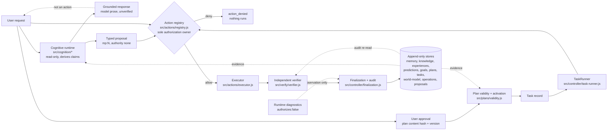

# APEX Local Alpha — consolidated architecture

This document is the single consolidated description of the cognitive runtime and the executive
system as they exist in `apex_app/` after Batch AO-10 and the bounded AP-01 through AP-05
pathways. It
replaces no code and grants nothing. It was written against commit `a2c9a64` (`ao-10`) plus the Batch
AP working tree, by reading the modules and tests named below. Where a statement is a contract enforced by code, the module is
named; where it is a guarantee established by tests, the suite is named; where it is only a
description, it says so.

Three evidence rules apply throughout:

- A passing test is evidence about this code on this platform with a deterministic fixture. It is
  not evidence about a real model, real-world truth, or secure operation in an adversarial
  environment.
- No test in this repository runs a model. Every backend is `NoBackend` or a programmatic stub with
  a fixed reply. The only real-model observations are the dated historical notes in
  [`README.md`](README.md#historical-record-the-controlled-real-model-run-of-2026-10-31).
- Model output, retrieved records, diagnostics, and handoffs are data. None of them authorizes an
  action.

## 1. Status vocabulary used below

| Status | Meaning |
| --- | --- |
| `IMPLEMENTED_AND_TESTED` | Code enforces the behavior, and at least one named test exercises it through a real module or child process. |
| `IMPLEMENTED_PARTIALLY_TESTED` | Code enforces it, but a named boundary has no direct test (for example, no killed child at that instant). |
| `IMPLEMENTED_NOT_DIRECTLY_TESTED` | Code exists and is reachable, but the test evidence is indirect or structural. |
| `DESCRIPTIVE_ONLY` | A written contract or observation exists; nothing enforces it. |
| `NOT_IMPLEMENTED` | No implementation exists. |
| `DEFERRED` | A decision was recorded not to build it in this batch, with the reason. |

## 2. System map



The right-hand side is the only path that can execute anything. The cognitive runtime and the model
sit on the left and can only describe, propose, or refuse. A proposal becomes execution only after
the registry allows it; a plan becomes execution only after a user approval is bound to its bytes and
the plan is activated into an ordinary task; every task step is authorized again when it runs.

## 3. A. Cognitive runtime

All modules in `src/cognition/` are deterministic and read-only unless stated. None writes a store,
calls a model, or grants authority. The model call itself is the gateway (`src/model/gateway.js`),
which the controller invokes; the cognitive runtime validates the reply afterward.

| Component | Module | Responsibility | Input → output | Persistence | Authority | Failure behavior | Tests |
| --- | --- | --- | --- | --- | --- | --- | --- |
| Request understanding | `cognition/request.js` | Classify intent, referents, time range, ambiguity, unsupported capability, missing information | Request text + store-derived context → structured understanding | None | None; description only | Ambiguity becomes a clarification before any model call; unsupported capability is named | `cognition-understanding.test.js`, `cognition-scenarios.test.js` D |
| Evidence retrieval | `cognition/evidence.js` | Bounded reads across memory, knowledge, experience, adaptation, temporal summary, prediction, World Model, goals/plans/tasks, conversation, request | Stores → one evidence shape per record, with source, validity, status, relationships; omissions counted | None | None | A source that was read and empty, unavailable, or damaged is kept distinct; absence is not negative proof | `cognition-reasoning.test.js`, `cognition-evidence-states.test.js` |
| Claim extraction and contradiction map | `cognition/claims.js` | Extract claims, classify kinds, reduce duplicates, keep both sides of a disagreement | Evidence → claims + contradiction map | None | None | Both sides retained; no recency/source-rank resolution | `cognition-lineage.test.js`, `cognition-evidence-states.test.js`, `cognition-scenarios.test.js` B |
| Deliberation | `cognition/deliberation.js` | Thirteen ordered deterministic steps from question to decision and disclosures | Claims + contradictions + uncertainty → deliberation result | None | None | A decision is `answer`, `clarify`, `abstain`, `refuse`, or `recommend`; no step executes | `cognition-reasoning.test.js`, `cognition-scenarios.test.js` |
| Grounded response construction | `cognition/response.js` | Build the bounded grounding brief, validate structured responses and plain answers, phrase disclosures, correct model action claims | Analysis → brief + validation result + disclosure text | None | None | A citation the model did not retrieve, a forged state, or an over-certain structure is rejected whole | `cognition-reasoning.test.js`, `cognition-evidence-states.test.js` |
| Model protocol | `cognition/protocol.js` | Extract, bound, parse, and reject the optional `COGNITION` line | Model text → parsed structure or refusal | None | None | Malformed, oversized, non-object, duplicate, or unknown-kind structures are rejected whole | `cognition-contract.test.js`, `proposal-boundary-an.test.js` |
| Model gateway | `model/gateway.js` | Replaceable backend; classifies every reply and records provenance | Request → `valid`/`empty`/`refused`/`unavailable`/`malformed`/`context_limit`/`cancelled` reply | None | None | Cancellation is distinct from timeout; only `UNREACHABLE`/`INTERRUPTED` retry; refusal/empty/malformed never retried into a different outcome | `gateway.test.js`, `gateway-resilience.test.js`, `runtime-states.test.js` |
| Model-output validation | `cognition/engine.js` + `response.js` | Validate the model's structure against this request's analysis and evidence ids | Model structure + analysis → accepted or rejected result | None | None | Never approves, writes, executes, or marks evidence verified | `cognition-contract.test.js`, `cognition-evidence-states.test.js` |
| Typed artifacts | `cognition/artifacts.js` | One shape per value crossing a stage boundary; validate at the boundary | Stage value → validated artifact or whole rejection | None | Each artifact states `authorizes: false` or an equivalent non-authority | Malformed or self-contradictory artifact is rejected whole; nothing is copied | `cognition-artifacts.test.js` |
| Lifecycle contract | `cognition/lifecycle.js` + `contract.js` | Ten stages as an executable state machine; allowed entry per stage; failed/skipped/unavailable stages close dependants | Stage events → lifecycle snapshot + audit | None (the audit is carried on the operation record) | None; `action_registry` named as owner | A stage cannot start from a failed prerequisite; a skipped authorization or execution cannot carry a dependent stage | `cognition-lifecycle.test.js`, `cognition-contract.test.js` |
| Cancellation and request identity | `lifecycle.js`, `controller/controller.js`, `session.js` | Request id; cancellation signal; distinguish cancelled from timeout; discard late replies | Signal + request id → terminal lifecycle state | Operation record only | None | A cancelled request records no answer and no execution; a late reply is discarded | `cognition-lifecycle.test.js` (real `cancelled-request-child.mjs`) |
| Cognitive trace | `cognition/trace.js` | Bounded audit trace: stages, counts, evidence ids, refusals, validation, execution boundary | Lifecycle + step records → trace | Attached to the operation record | None; every trace says `authorizes:false` | Free text is filtered against fixed labels; prose and reasoning cannot enter | `cognition-trace.test.js` |
| Evidence lineage | `cognition/lineage.js` | Record what a claim rested on; later re-assess against current records without rewriting history | Claim + recorded refs → snapshot + separate reassessment | Snapshot is carried in the operation/cognition audit | None | Missing/unreadable evidence → unverified, never false; retracted/superseded → weakened | `cognition-lineage.test.js` |
| Late evidence re-check | `cognition/evidence.js` (`recheckEvidence`) + `controller.js` (`#recheckAnswerEvidence`) | Re-read only cited memory/knowledge ids after the model answers; report changes | Recorded claims + stores → `evidenceRecheck` record + display notice | Read-only; attached to the operation | `authorizes: false`; never rewrites lineage | Unreadable record → weakened to unverified; unavailable source named; bounded to 128 ids | `acceptance-ao09.test.js` 4-5 |
| Deterministic evaluation | `cognition/evaluation.js` | Fixed synthetic scenarios over the deterministic pipeline; per-dimension findings; no composite score | Scenarios → findings + pass/fail per dimension | None; pure and non-mutating | None | A finding names the defect class; a pass means the implementation matched the written rubric | `cognition-evaluation.test.js`, `acceptance-ao09.test.js` 6 |
| Runtime diagnostics | `cognition/runtime-diagnostics.js` | Bounded per-request stage record: outcomes, durations, counts, cancellation, failure, retries | `SpanRecorder` + lifecycle → diagnostics record | Attached to the operation line already being appended | `authorizes: false`; nothing reads it to decide | Clock fault → duration `null`; build failure → `available:false`; outcome/status untouched | `runtime-diagnostics-ao.test.js` |

What this layer does **not** do: it does not simulate understanding, does not produce a confidence
score, does not resolve a contradiction, does not turn a model answer into a verified fact, and does
not authorize. Its outputs are the input to the model prompt, or the validation of the model's
output, or a record attached to an operation that has already been decided elsewhere.

## 4. B. Executive system

| Component | Module | Responsibility | Authority owner | Persistence | Failure behavior | Tests |
| --- | --- | --- | --- | --- | --- | --- |
| Goals | `goals/model.js`, `goals/store.js`, `goals/assess.js`, `actions/goal-actions.js` | Goal records, criteria, legal transitions, evidence rules, append-only reducer; completion requires a live `success_verified` audit operation | User (`goal add/update/evidence/complete/link`) | `goals.jsonl` under the goal write lock | No evidence → not complete; conflicting evidence → not satisfied; a model cannot write | `goal-system.test.js`, `goal-provenance.test.js`, `goal-assessment.test.js`, `goal-evidence-consistency.test.js` |
| Candidate planning | `plans/candidates.js`, `plans/evaluation.js`, `executive/selection.js` | Candidate approaches the recorded goal supports; gate-then-Pareto comparison; each step names a registered action | User records and approves; nothing starts | Draft plans in `plans.jsonl` only after the user acts | An unavailable capability excludes the candidate; unmappable parts stay recorded unknowns | `plan-candidates.test.js`, `plan-generation.test.js`, `plan-evaluation.test.js`, `plan-dimensions.test.js` |
| Plan validation | `plans/validity.js`, `plans/model.js` | Validate live registry, dependencies, goal revision, evidence, constraints, approval binding | Controller on activation; registry on each step | `plans.jsonl` | A stale approval, missing action, failed dependency, or unreadable constraint refuses activation | `plan-constraints.test.js`, `plan-continuation.test.js`, `plan-adversarial.test.js` |
| User approval and hash binding | `plans/model.js`, `executive/preview.js`, `actions/plan-actions.js` | Approval is a user-origin event bound to plan version + content hash; preview prints what is approved | User only | `plans.jsonl` (`plan.approval`) | A revision clears approval; an approval from another version/hash cannot activate new bytes | `handoff-hash-binding-ao.test.js`, `executive-acceptance.test.js` K-04, K-22 |
| Authorization | `actions/registry.js` | Every action declares permission (`read`/`write`) and origins; write actions are user-only; a model-origin write cannot be registered | Action registry | None (policy in code) | Unknown action/origin denied; denied step executes nothing | `model-self-authorization.test.js`, `proposal-boundary-an.test.js`, `capability-inventory.test.js` |
| Executive handoff | `executive/handoff.js`, `executive/mapping.js` | Record each crossing as one bounded handoff: model proposal, plan activation, or task run; ids, hashes, recorded outcomes | None; every handoff says `authorizes:false` | Attached to the operation record | Invalid construct or stale reference fails closed; no request/input/model text | `handoff-integrity-ao.test.js`, `handoff-hash-binding-ao.test.js`, `executive-bridge.test.js` |
| TaskRunner | `controller/task-runner.js`, `tasks/model.js`, `tasks/store.js` | Run each step through the controller's existing action path; own task/step transitions; record one `task.step` operation per executed step | Task creation (user) or task approval (user, for model-proposed tasks); registry per step | `tasks.jsonl` under the task lock | A failed step stops dependants; an interrupted step is uncertain, never success; no replay | `tasks.test.js`, `task-lifecycle.test.js`, `executive-acceptance.test.js` K-13–K-18 |
| Execution | `actions/executor.js`, `actions/builtin.js`, `actions/*-actions.js` | Validate input and run the action body; report what happened only | Registry already allowed it | The action's own store | Validation error → `input_rejected`; body throws → execution failed; no verification claimed | `actions.test.js`, `failure-semantics.test.js` |
| Independent verification | `verify/verifier.js` | A different component re-reads the store or recomputes the value and decides the postcondition | None; it reports only | None | Verifier unavailable/failed → not success; independent of executor | `executive-acceptance.test.js`, `executive-bridge.test.js`, `integration-runtime-an.test.js` |
| Finalization and audit | `controller/finalization.js`, `operations/operation-log.js` | One completion contract for every path: audit append, experience capture, completion; masking and minimization at the write boundary | Operation log's single append path | `operations.jsonl` | Audit append failure downgrades success and reports `recorded:false`; never invents experience | `finalization-contract.test.js`, `finalization-interruption.test.js`, `append-audit-failure-semantics.test.js` |
| Continuation and recovery | `plans/continuation.js`, `continuation/engine.js`, `executive/recovery.js`, `tasks/lock-recovery.js` | Read nine states from plan/task/audit records; take up only steps proven never to have started; refuse to replay an uncertain effect | User initiates continuation; no background recovery | Reads only; the resulting step runs through the normal path | A refused or unsafe continuation executes and writes nothing; a second continuation takes up nothing | `plan-continuation.test.js` (real children), `continuation-cross-process-an.test.js`, `executive-readiness.test.js`, `expectation-caution.test.js` |
| Prediction and experience | `prediction/*`, `experience/*`, `actions/prediction-actions.js`, `actions/experience-actions.js` | Append-only expectation and experience records; feedback; adaptation candidates; outcome evaluation derived at read time | User writes only; a model cannot write | `predictions.jsonl`, `experiences.jsonl` under their locks | An expired horizon is not a wrong prediction; a rate below 20 evaluations is withheld; a damaged store is unavailable, not empty | `prediction-*.test.js`, `experience-*.test.js` |
| Adaptation boundary | `experience/derivation.js`, `experience/experience-store.js`, `plans/guidance.js` | Repeated user corrections may yield one candidate rule; only a user decision approves it; an approved rule may shape (never gate) a later selection | User approval only | `experiences.jsonl` | A retired rule shapes nothing; two conflicting approved rules are disclosed, neither chosen | `experience-adaptation.test.js`, `plan-guidance.test.js`, `adversarial-batch-am.test.js` I-01–I-08 |
| Decision adaptation (AP-01) | `plans/evaluation.js` (`adaptationDecisionOf`), `plans/guidance.js`, `executive/selection.js` | One approved, shaped adaptation may change only which candidate leads a comparison; the decision block states the order the same rule would have produced without it, with rule ids, versions, hashes and bounded evidence ids | User approval only; the block says `authorizes:false` | None; carried on the audited `plan.candidates`/`plan.replan` read and its display | No applicable record → declined with the ledger's own reason; candidate bytes that changed since the comparison are refused by selection | `adaptation-decision.test.js`, `plan-guidance.test.js`, `plan-learning.test.js` |
| Prediction-derived adaptation (AP-02) | `experience/prediction-derivation.js`, `experience/experience-store.js`, `actions/experience-actions.js` (`adaptation.derive`, `adaptation.eligibility`) | One completed, valid evaluation of one user-recorded prediction may become a bounded, typed adaptation **candidate**; the user inspects it and approves it through the existing `adaptation.decide`; only then does it feed the same AP-01 dimension | User approval only; derivation only creates a candidate; the candidate cannot serialize any executable text | One adaptation record and its lifecycle events in `experiences.jsonl`, unchanged in shape; `predictionEvidence` on the record is a pointer, and currentness is re-read from `predictions.jsonl` | Awaiting / expired / invalidated / superseded / conflicting / stale / model-origin / duplicated evidence is inert with a state; stale or unreadable lineage forces `active:false` on read; no parallel learning store | `prediction-adaptation-learning.test.js` (21 cases), `adaptation-decision.test.js`, `prediction-adaptation-boundary.test.js` |

### Who owns each transition

| Transition | Owner | Record that establishes it |
| --- | --- | --- |
| Interpret a request | Cognitive runtime | Analysis on the operation record (`authorizes:false`) |
| Retrieve evidence | Cognitive runtime | Evidence ids and counts on the analysis |
| Ask the model | Controller, through the gateway | Gateway reply classification + provenance (`verified:false`) |
| Validate model output | Controller | Validation result; rejection is disclosed |
| Propose an action | Model (untrusted) | Typed proposal `mp:N`, `authority:'none'` |
| Approve a plan | User | `plan.approval = { at, version, contentHash, validation }` |
| Validate and activate a plan | Controller | `plan.activation` + `plan.activate` handoff |
| Authorize an action | Action registry | Step `authorization` field |
| Execute an action | Executor | Step `execution` field |
| Verify a result | Independent verifier | Step `verification.outcome` |
| Record the operation | Finalization contract | Whether the audit line was appended |
| Continue an interrupted run | User, explicitly | Continuation reading + new step records |

### The one decision an approved record may move (AP-01)

The pathway is: **a recorded outcome → an approved adaptation with a recorded shape → one later
comparison's ordering → the decision states what it would have been without the record → retirement
restores the unadapted ordering.** It uses the existing experience store, the existing one-user
approval (`adaptation.decide`), the existing shape record (`adaptation.guide`), the existing
retirement event (`adaptation.retire`), and the existing gate-then-Pareto comparison. No store,
planner, registry, authorization rule, or execution path was added.

- **Decision point.** Only the *leading candidate* of a `plan.candidates` or `plan.replan`
  comparison can move, and only through the one ranked dimension `approved_adaptation_fit`. The
  eligible signal is the user's recorded feedback/experience that supports an adaptation the user
  approved. A model suggestion or an unapproved candidate rule is never an eligible signal: the
  eligibility and adversarial suites prove each has no effect. A prediction verdict reaches this
  point only after a user-approved prediction-derived candidate exists (AP-02, below); the verdict
  alone does nothing.
- **Eligibility rules.** A record can move the ordering only when all of these hold in the ledger
  read for this comparison: the user approved it; it is active; its supporting evidence still
  stands; it has a recorded shape; its scope names a capability these candidates use; it does not
  contradict another active record in its scope; and the fields it states are answerable by the
  candidates' own steps. Anything else is reported with the state that made it inert
  (`candidate`, `rejected`, `retired`, `ambiguous`, `stale`, `unshaped`, `out_of_scope`,
  `conflicted`, `contradicted`) and moves nothing. Unknown fields, a malformed shape, or a step
  bound outside 1–8 are refused by the store before any comparison sees them.
- **What the decision discloses.** The `adaptationDecision` block carries the schema
  `apex.adaptation-decision.v1`, the dimension it can move, the front and leading candidate
  *without* the dimension and *with* it, whether the record applied and whether the outcome changed,
  the applied rules (id, capability, version, rule hash, bounded support ids), the deduplicated and
  bounded evidence ids, every record considered with its state and reason, the ledger's own
  decline reason when nothing applied, the guidance digest, and `authorizes:false`. It carries no
  free-form reasoning and no score.
- **Authority boundary.** The block is computed after the gates, the included set, the candidate
  bytes, the ranked dimensions and the front are already fixed; it cannot re-admit a gated
  candidate, change a step, change an approval, change authorization, change verification, or start
  anything. `selectCandidate` additionally refuses a leader whose digest no longer matches the
  candidate list, so an influenced comparison cannot record bytes it did not read. The plan that
  results is still an ordinary draft that needs the user's approval and the normal validation.
- **Reversal.** `adaptation.retire` is the reversal. The records are append-only: the approval, the
  shape, the support and the retiring event all remain. The next comparison reads the retired state,
  reports it as inert with its reason, applies nothing, and produces the same ordering the
  unadapted rule produced before approval. Reversal never rewrites the earlier decision, never
  changes an approved or executed plan, and never changes a historical audit line.
- **Tests and cost.** `tests/adaptation-decision.test.js` covers eligibility, malformed/unknown
  rules, duplicate evidence, the before/after/after-reversal fixture, selection refusal on changed
  bytes, model-origin refusals, expired/awaiting predictions, authorization and registry
  invariance, and audit-write failure. The decision path was measured before (the module extracted
  from the pre-AP commit) and after, in one process, at 4 / 10 / 20 candidates: the added block
  costs about 0.04 / 0.01 / 0.41 ms, or 25% / 3% / 48% of a comparison that itself takes
  0.14 / 0.26 / 0.85 ms. No cache or index is justified by these figures.
- **What it does not claim.** An applied record orders approaches; it does not predict that the
  ordered approach will succeed, does not establish a causal effect of past outcomes, and does not
  fit a weight or recompute a ranking from results. Prediction verdicts have no effect of their own:
  they reach this pathway only through a user-approved prediction-derived candidate (AP-02, below).

### How a prediction verdict may inform that one decision (AP-02)

Batch AP-02 extends the same pathway to a second kind of recorded evidence — an expectation the user
recorded and a verdict a deterministic evaluation derived from it — **without a parallel learning
system**. It adds one pure derivation module, one read action, and a prediction branch inside the
existing derivation and store; it adds no store, no planner, no registry entry, no authorization
rule, and no second decision dimension. The five transitions are separate and each is a different
fact:

| Transition | What establishes it | What it does **not** do |
| --- | --- | --- |
| **Recorded** | `prediction record`: the user states an expectation, a capability, a horizon, and cited evidence; user origin only | It is not an observation, a verdict, or a rule; no model can write one |
| **Evaluated** | `prediction evaluate`: compares the expectation with outcome experiences inside the horizon and stores a verdict only when they establish one | It does not approve an adaptation, create a candidate, or change any other record |
| **Eligible** | `predictionEligibility` over a projection: completed, valid, current evidence, readable lineage, current outcome records | It does not derive or approve anything; it only answers whether a candidate *could* rest on this evaluation |
| **Approved** | `adaptation.decide` by the user on a derived candidate, appended to `experiences.jsonl` | Approval is not inferred from a successful evaluation, and it grants no permission |
| **Influencing** | The AP-01 read: approved + active + intact support + a recorded shape + current prediction evidence, feeding only `approved_adaptation_fit` | It cannot change candidate bytes, gates, plan steps, goal criteria, approvals, authorization, execution, or verification |

- **Eligibility rules (closed states).** `experience/prediction-derivation.js` judges one projection:
  a missing projection or a status other than `evaluated` is `not_evaluated`; a scope that is not a
  capability name is `not_scopable`; a non-user origin is `provenance_not_user`; a withdrawal is
  `invalidated`; a replacement (or a retired flag) is `superseded`; no stored evaluation is
  `evaluation_missing`; a recorded verdict a fresh read would settle differently is
  `evaluation_stale`; an unreadable experience log is `evidence_unavailable`; a cited record that
  does not resolve is `unresolved_citation`; an evaluation that cites no still-current outcome
  experience, or names no deciding outcome class, is `outcome_evidence_not_current`. Any state other
  than `eligible` is inert and carries its reason. Awaiting and expired predictions never reach
  `evaluated`, so they are inert; expired is not incorrect.
- **What the proposal may say.** The mapping is the explicit, closed `OUTCOME_PROPOSAL_FIELD`:
  a recorded `success` proposes `prefer` for the capability; `failure` and `blocked` propose
  `avoid`. The *verdict word* is not the rule — a contradicted verdict still follows the recorded
  outcome class, and the mapping is printed in the record so a reader can disagree with it. The
  prediction's own subject text is display-only and is never parsed; the proposal is a typed
  object (`type: 'evaluated_prediction'`, `dimension: 'approved_adaptation_fit'`,
  `guidance: { order, avoid, prefer, maxSteps }`, `verdicts`, `limitations`, `evidenceDigest`), and
  an unknown type or malformed field is refused. There is no free-form text that can execute.
- **One evaluation, one candidate.** Derivation stores a candidate with
  `method: 'evaluated_prediction'`, `minSupport: 1`, and exactly one prediction id and one
  evaluation id in `support`. Repeated derivation with the same prediction is skipped, a duplicate
  citation cannot add a second candidate, and the decision's evidence lists are deduplicated and
  bounded. A prediction-derived proposal whose normalized scope-and-rule key equals an existing
  rule does not create a parallel rule for the same scope.
- **Approval is unchanged and explicit.** `adaptation.derive` only appends an unapproved candidate;
  its independent verification re-reads the record and refuses if the candidate is active, if its
  provenance is not deterministic derivation, or if it does not cite exactly one current prediction
  and evaluation. `adaptation.decide` remains the only approval, remains user-origin only, and
  verifies that the decision did not change the candidate's rule or scope. A successful evaluation
  is never treated as consent.
- **Currentness is re-read, not cached.** The store overlays a prediction-derived record on read
  with `source: 'prediction'`, `shapeSource: 'proposal'`, and `predictionEvidence`. For every active
  prediction-derived row it re-reads the `predictions` ledger once (`details`, the batch read added
  in AP-03; no retention between checks, no index) and forces
  `active:false` with an `inactiveReason` of `prediction_store_unavailable` or `evaluation_changed`
  when the ledger no longer supports the record. An approval is preserved; its effect is withdrawn
  until the lineage is explicitly reconciled. A re-evaluation or invalidation therefore cannot leave
  stale guidance active.
- **Disclosure is the AP-01 block.** `adaptationDecision` is unchanged in schema
  (`apex.adaptation-decision.v1`), carries `authorizes:false`, and gains only a per-rule
  `source`/`method` and a `sources.predictionEvidence` distinction: `none` when no prediction record
  was considered, `both` when feedback- and prediction-derived rules both applied,
  `prediction_derived` when only a prediction-derived rule applied, and `prediction_rejected` when
  prediction evidence was considered and could not be used, naming each rejected record and its
  state. Feedback-only is `predictionEvidence: 'none'` with a non-empty `feedbackDerived` list. The
  counterfactual removes `approved_adaptation_fit` exactly as AP-01 did; there is no new dimension.
  A combined outcome never double-counts one prediction: the same record id appears once, and the
  evidence lists are per-kind.
- **Reversal and lineage.** `adaptation.retire` works identically for a prediction-derived record:
  the candidate, decision, proposal and prediction/evaluation ids stay readable, and the next
  comparison returns the unadapted order. Retirement or invalidation of the prediction itself makes
  the record ineligible on the next read rather than rewriting history; an existing decision is never
  retroactively changed, and no already-approved plan or executed task is altered.
- **Tests and cost.** `tests/prediction-adaptation-learning.test.js` (21 cases, registered in
  `npm test`) covers the eligibility matrix, inert waiting/expired/invalidated/superseded evidence,
  stale and unreadable lineages, model-origin refusal, duplicate non-amplification, approval
  separation, typed-rule refusal, the five disclosure distinctions, the real-store/controller/audit
  end-to-end run, retirement, and audit-append failure. The pure decision path was benchmarked
  against AP-01 on identical fixtures (see `benchmarks/README.md`); it shows no measurable added
  overhead there. The AP-02-specific cost is the currentness store read, and AP-03 turned it from
  one ledger read per cited prediction into one ledger read per check (see below).
- **What it does not claim.** It does not claim APEX predicts accurately, that a prediction is a
  probability, that an evaluated outcome caused the later result, or that any of this improves work.
  It claims only that one completed evaluation can become a candidate, that only the user's approval
  makes it evidence, and that the resulting ordering influence is disclosed, bounded, auditable and
  reversible.

### How repeated recorded outcomes may be described and, separately, approved (AP-03)

Batch AP-03 extends AP-02 from one evaluated prediction to a bounded sequence of them. It answers a
narrower question than "what always happens": *in one capability's recorded history, is the order of
recorded outcomes repeated, alternating, turning, or not enough to say?* The answer is a read-time
analysis, not a stored fact. It adds one pure module (`prediction/longitudinal.js`), a derivation
branch that may cite several evaluations, one read action (`longitudinal`), and one batched ledger
read used by the currentness check. It adds no store, no new prediction or experience file, no
planner, no new permission or origin, no authorization rule, and no second decision dimension.

- **Read-only analysis.** `analyzeLongitudinal` takes the predictions whose evaluation is known and
  projects a scoped report. Nothing is written: no record is repaired, promoted, or annotated, and
  the ledger is only read. The report carries schema `apex.longitudinal.v1` and repeats the note
  that it "makes no causal claim, states no confidence, and approves nothing".
- **The pattern vocabulary is closed.** Eight kinds, no free-form parsing:
  `repeated_success`, `repeated_failure`, `alternating_outcomes`, `consistent_improvement`,
  `consistent_regression`, `mixed_outcomes`, `insufficient_evidence`, `conflicting_evidence`. The
  first four state a direction a candidate may carry; the last four describe evidence that supports
  no single direction and therefore propose nothing. `MIN_REPEATED_OBSERVATIONS = 2` and
  `MIN_SEQUENCE_OBSERVATIONS = 3` are definitions of "repeated" and "a sequence", not accuracy
  thresholds: two observations can repeat, and three are needed before an order can alternate or
  turn.
- **Grouping, dedupe and exclusions.** A group is one capability name; a parent name never absorbs a
  child capability's records, and unrelated capabilities are never merged. Observations are ordered
  chronologically by recorded outcome time, deduplicated by prediction id and evaluation id, and each
  observation names its own prediction, evaluation and evidence ids. A citation cannot count twice.
  Records withdrawn, replaced, expired, stale, unreadable, non-user, or outside a capability scope are
  **excluded by kind**, each with its wording; the report prints up to 20 exclusions per group and
  says when it truncated. A missing record is never read as a failure: absence is an exclusion with
  a reason, and an unreadable store is a refusal, not an empty history.
- **Calibration is separate and unchanged.** The existing derivation is reused verbatim, with its
  floor of **20 scored evaluations** intact. The report states recorded, evaluated, eligible-scored
  and excluded counts; below the floor, calibration is explicitly `unavailable` with the reason
  `below 20`, and is never read as a good or poor rate. Calibration is not authorization.
- **Bounded reads are disclosed.** The derivation reads at most 20 predictions
  (`MAX_LONGITUDINAL_PREDICTIONS`). When the scope holds more, the read is partial, the report says
  so, and **no pattern is derived from it**: a rule is refused rather than inferred from a prefix of
  the history. The report also bounds groups (20), observations and exclusions shown per group (20),
  and support refs per rule (20), and says which of those it hit.
- **A pattern may become a candidate; it never approves one.** `adaptation.derive` turns a
  directional pattern into a candidate with `method: 'repeated_outcome_pattern'`, an explicit
  `type: 'repeated_outcome_pattern'` proposal, `minSupport: 1`, and the cited prediction and
  evaluation ids in `support` (bounded at 20). The rule is the recorded pattern's direction mapped
  through a closed mapping, printed in the record so a reader can disagree with it; the predictions'
  subject text is display-only and never parsed. `adaptation.decide` remains the only approval and
  remains user-origin only. A repeated pattern is never automatically promoted to an executable rule.
- **One scope, one answer.** The scope is answered by its pattern, not also by each member: a
  prediction covered by the longitudinal candidate is not additionally turned into its own
  single-evaluation candidate. Normalized scope-and-rule keying still prevents a parallel rule for
  the same scope, and the derivation's independent verification refuses a candidate whose citations
  no longer resolve.
- **Influence is the AP-01 dimension, with a distinguishable basis.** An approved longitudinal
  candidate feeds only `approved_adaptation_fit`. The decision block gains
  `sources.longitudinalDerived` beside `sources.singleEvaluationDerived` and
  `sources.predictionEvidence`, and each applied rule carries `basis` (`repeated_feedback`,
  `single_evaluation`, or `longitudinal_pattern`), so a reader can tell a single observation from a
  supported sequence. The counterfactual, candidate bytes, gates and ranked dimensions are
  unchanged; there is no new dimension and no new authorization pathway.
- **Currentness is one ledger read per check.** Every adaptation read re-judges each cited
  prediction against the live ledger via `predictions.details`, which reads and projects the log
  once for all references (including the predictions cited by longitudinal candidates). Nothing is
  retained between checks, so a re-evaluation, invalidation, or a later outcome inside a cited
  horizon makes the record ineligible until reconciled; the approval stands, its effect is withheld,
  and on reconciliation the unadapted decision returns without any record being rewritten.
  `tests/longitudinal-outcome-analysis.test.js` asserts the batched read returns exactly what one
  read per citation returned.
- **Reversal.** `adaptation.retire` remains the reversal for a longitudinal record exactly as for
  AP-01/AP-02: the retire event is appended, the next comparison reports the record inert with its
  reason and restores the unadapted ordering, and no prediction, evaluation, feedback, adaptation,
  plan or task history is rewritten.
- **Tests and cost.** `tests/longitudinal-outcome-analysis.test.js` (registered in `npm test`)
  covers the vocabulary and eligibility matrix, calibration at 19 vs 20, duplicate evaluations and
  citations, exclusion kinds (expiry is not failure, missing is not failure), mixed/alternating
  groups, unrelated capabilities, conflicting and damaged-store evidence, model-origin
  ineligibility, that aggregation can neither approve nor activate, that only an approved adaptation
  moves the dimension, re-evaluation/invalidation removing influence, retirement restoring the
  baseline, refusal to bypass plan approval/authorization/execution/verification, concurrent changes
  not leaving stale influence, and a deterministic end-to-end run through real stores, controller and
  audit. `benchmarks/run-longitudinal-benchmark.mjs` measures the pure analysis as history grows
  (20 / 100 / 500 / 1000 evaluations) and the **complete** production request path. With one
  capability and 8 / 14 / 19 recorded evaluations the AP-03 rule moves the decision by a median
  `+1.2 / +5.8 / +7.1 ms` over the no-rule request, against AP-02's `+0.5 / +19.1 / +2.3 ms`; the
  figures include the currentness read and machine noise and are observations of one machine, not a
  specification.
- **What it does not claim.** A repeated association in recorded order is not a cause, not a
  probability, not a confidence, and not a forecast. The analysis does not say a capability will
  succeed, does not fit a weight, does not compute an accuracy, and does not approve, activate, or
  execute anything. It claims only that a bounded, scoped, deduplicated sequence of recorded outcomes
  can be described and shown, that a directional one can become a candidate, and that only the user's
  explicit approval lets it move one disclosed comparison.

### How an approved adaptation is traced to its outcomes, without claiming cause (AP-04)

Batch AP-04 answers a different question from AP-01 through AP-03. Those batches let a record move
one disclosed comparison; AP-04 asks whether the *decisions that record was actually part of* were
followed by better, worse, or unchanged recorded outcomes. It adds one pure read module
(`plans/effectiveness.js`), one read action (`adaptation.effectiveness`), a controller method and a
CLI command. It adds no store, no new record type, no planner, no permission or origin, no new
decision dimension, and no execution path. Nothing in the read approves, guides, retires, retries, or
executes anything.

- **Approval is not application, application is not success, and success is not cause.** The read
  keeps these four apart in its own vocabulary. A record with a decision and no disclosed use is
  `approved_never_applied`; a use whose plan has not reached an outcome is `applied_outcome_pending`;
  a verified execution whose assessment failed is `applied_failed`, not a success; and an evaluated
  success is only ever described as an association with the plan that ran under the rule, never as
  something the rule caused.
- **Lineage.** Each use is reconstructed from records that already exist: the adaptation's rule,
  version and hash → the decision disclosure recorded in the `plan.candidates` operation → the
  candidate and plan identity that disclosure named → the plan's activation, step operations and
  audit records → the per-step verification outcomes → the plan assessment and its outcome evidence.
  Ids and content hashes from those records are the join keys; no id is invented and no record is
  rewritten. A use whose decision cannot be established is excluded with its reason rather than
  inferred from eligibility.
- **The comparison is a disclosure, not a baseline trial.** For every use the read states which
  candidate led before and after the rule, whether selection changed, whether execution followed,
  what verification reported, and whether a comparable unadapted outcome exists. The unadapted
  decision was a *disclosed* alternative that was not executed, so its outcome is reported
  `unavailable` and is never estimated, imputed, or manufactured. No baseline plan is created or run.
- **Classification is one closed state per adaptation.** Sixteen states, computed from the uses and
  the plan/assessment records: `not_approved`, `approved_never_applied`, `applied_outcome_pending`,
  `applied_successful`, `applied_partially_successful`, `applied_failed`,
  `applied_blocked_or_uncertain`, `applied_awaiting_confirmation`, `applied_insufficient_evidence`,
  `applied_conflicting_evidence`, `applied_mixed_outcomes`, `applied_not_changed`,
  `applied_unattributed`, `applied_to_earlier_version`, `retired_before_evaluation`, and
  `ineligible_support_invalid`. A `blocked` or `uncertain` outcome is never converted into a failure;
  a cancelled plan and a missing record are `insufficient_evidence`, not success; a use tied to an
  older rule version is `applied_to_earlier_version` rather than counted under the current one.
  Conflicting assessments are preserved as `applied_conflicting_evidence`.
- **The outcome vocabulary is closed.** Effective outcomes are `successful`, `failed`,
  `partially_successful`, `blocked`, `uncertain`, `awaiting_confirmation`, `insufficient_evidence`,
  and `conflicting_evidence`. Real-world success is never inferred from a successful execution alone:
  a use is only `successful` when the plan's own assessment established it, which for this plan model
  requires goal-criterion evidence.
- **Aggregates are counts, stated with their scope.** Each adaptation row carries raw uses and
  per-version counts, the outcomes observed under the adapted and unadapted attributions, the
  inclusion/exclusion counts, the read window, and the rule versions seen. The report separates the
  records from the summary and never invents a confidence percentage, success probability,
  significance test, or causal explanation. A sample under the thresholds stays explicitly
  `insufficient_evidence`.
- **Bounded and fail-closed.** The read takes at most 20 adaptations (`MAX_EFFECTIVENESS_ADAPTATIONS`),
  at most 100 uses in total (`MAX_EFFECTIVENESS_USES`), keeps at most 10 use samples per row for
  display while reporting the true counts, and scans at most 20,000 audit records (`MAX_AUDIT_SCAN`),
  saying which bound it hit. A damaged or unreadable store is a refusal, not an empty history: the
  same `StoreError` the other reads raise. The read re-runs itself to verify its digest, so a change
  between the two reads (an approval, a guidance change, a retirement, a new plan or assessment, a
  differently linked use) is reported as a failed verification instead of a stale report.
- **User-controlled review, not optimization.** The report may recommend *review* and may name
  `consider_retirement`; it cannot retire. Retirement remains `adaptation.retire`, rule changes remain
  `adaptation.guide`, and the read cannot approve, execute, retry, or change a plan, a goal, or a
  task. `authorizes` is `false` on every report, and the rendered display says the read approves
  nothing, changes no rule, retires no adaptation, and executes no task.
- **Tests and cost.** `tests/adaptation-effectiveness.test.js` (registered in `npm test`) covers the
  lifecycle states, lineage and version attribution, conflicting and insufficient evidence, damaged
  stores, bounded and concurrent reads, counterfactual limits, that approval is never treated as
  application or success, that a record cannot retire itself, and a deterministic end-to-end run
  (approve → influenced decision → separate plan approval → execution → verification → outcome →
  assessment → review → optional retirement → baseline decision restored).
  `benchmarks/run-effectiveness-benchmark.mjs` measures the **complete** verified request as the
  number of linked uses and stored adaptations grows, plus concurrent reads beside writes, with the
  partial store and audit reads printed separately and labelled partial. On this machine the complete
  request took a median 52.3 / 146.7 / 318.4 ms at 4 / 12 / 24 linked uses and 316.4 / 320.4 / 337.9 ms
  at 1 / 8 / 20 stored adaptations; the pure analysis was 27.5 / 71.4 / 167.6 ms. A target outside the
  newest-20 window was disclosed and not read. Observations of one machine at one time, not a
  specification.
- **What it does not claim.** No proven causality, no guaranteed improvement, no autonomous rule
  optimization, and no automatic retirement. An association between an approved rule and a later
  assessed outcome can have many other causes, including the user's own choices, and the report says
  so.

### How a governance review is bound to evidence (AP-05)

Batch AP-05 answers the question AP-04 can only raise. When the effectiveness report says an approved
record needs attention, a user can open a governance review against the exact evidence the stores hold
at that moment, inspect and reconcile it later, and record one of three lifecycle decisions. It adds
two record kinds to the existing experience store (`adaptation_review`, `adaptation_review_decision`),
one canonical evidence module (`experience/review.js`), one pure analysis module (`plans/governance.js`),
five actions, a controller surface and four CLI commands. It adds no store, no new authority, no
planner, no decision dimension, no execution path, and no second retirement mechanism.

- **The evidence is a canonical snapshot, not a live pointer.** A review cites the adaptation id and
  capability; the rule text, hash, version and shape; the adaptation's decision state, active/retired
  flags, support state, source and conflict ids; the report's availability, state, summary,
  recommendation and observations; the supporting, missing and superseded experience and feedback ids;
  up to 20 prediction/pattern refs; up to 20 uses with their recorded outcome; up to 20 plan and goal
  refs; and the read bounds. One function fixes field order and bounds, so two bundles compare by
  SHA-256 digest. Each reference list is separately capped at 20; the pattern is one reference. The report digest is recorded separately because it covers the whole report and can
  move while nothing the review cites changed.
- **Reader state is derived on every read, never stored.** Stored records are only the review and the
  user's decision; a stored status beside the evidence would be a second, editable copy of what the log
  already says. The closed vocabulary is `no_review_required`, `review_recommended`, `review_opened`,
  `review_awaiting_evidence`, `review_evidence_changed`, `review_completed`, `review_dismissed`,
  `review_decision_superseded` and `review_unavailable`. A review opened before the report could
  classify an evaluated use of the current version is `review_awaiting_evidence`, not success and not
  failure.
- **Three decisions, one existing retirement authority.** `keep_active`, `dismiss` and `retire` are
  user-origin writes. A decision is refused if the evidence changed after the review was opened - the
  user must reconcile first. `retire` appends the existing `adaptation_retirement` record through the
  existing `adaptation.retire` authority, then records the decision citing the pre-retirement evidence
  digest; a retired adaptation cannot be used or reviewed again, so the decision is terminal. Decisions
  are append-only and never rewritten; a later review supersedes an earlier undecided one.
- **Reconciliation names differences, not verdicts.** The reconciler re-derives the bundle and compares
  it item by item under a closed, ordered vocabulary: `unchanged`, `added`, `stale`, `conflicting`,
  `withdrawn`, `superseded`, `missing`, `unreadable`. `added` is not an improvement; `withdrawn`,
  `superseded` and `missing` are not a failure; a rule version change is `stale` while a rule hash
  change at the same version is `conflicting`; conflicting evidence stays conflicting; an item behind a
  truncated read is `unreadable`, never `withdrawn`; and a moved report digest alone is not an evidence
  change. A changed digest means reconcile before deciding, never better or worse.
- **Bounded and fail-closed.** At most 20 adaptation rows per list read (`MAX_GOVERNANCE_ADAPTATIONS`,
  the AP-04 bound), 20 evidence references per list, 20 reviews read per adaptation history, and 40
  change entries. A damaged experience or plan store raises `StoreError`; a missing plan store yields
  `review_unavailable` with its reason and a `null` reconciliation rather than an empty bundle. An
  audit-append failure after a decision is disclosed, and the decision the store already recorded is not
  erased.
- **Tests and cost.** `tests/adaptation-governance.test.js` (41 cases in 8 suites, registered in
  `npm test`) covers the nine states and three decisions, evidence identity, reconciliation precedence
  and every change kind, stale/conflicting/missing/unreadable evidence, model-origin refusal at the
  registry and the store, concurrent open/retire/reconcile, restart persistence, audit-append failure,
  damaged and missing stores, and two deterministic end-to-end paths. `benchmarks/run-governance-benchmark.mjs`
  measures the complete verified list/open/inspect/reconcile/decide path. On this machine the list
  request took a median 166.3 / 474.2 / 996.0 ms at 4 / 12 / 24 linked uses, open 151.7 / 445.1 / 640.1
  ms, inspect 338.7 / 667.0 / 1,231.2 ms, reconcile 240.9 / 632.5 / 1,160.7 ms, and decide 163.9 /
  345.8 / 608.5 ms; at 1 / 8 / 20 stored adaptations the list took 967.8 / 997.4 / 1,049.9 ms. At 21
  stored adaptations the target falls outside the newest-20 window and is not reported, which the
  report says. Observations of one machine at one time, not a specification.
- **What it does not claim.** Opening a review approves nothing, changes no rule, increases no
  influence, and executes nothing; a recommendation is never a decision. The read has no write path,
  and the write actions cannot approve an adaptation, change guidance, or run a plan. Reconciliation
  reports a difference, not a causal finding, a quality judgment, or real-world truth.

### A wrong expectation as one recommendation (AP-13)

The prediction ledger could state that an expectation ended as `contradicted`, and nothing downstream
read it. AP-13 adds the smallest consumer that closes that clause without turning a verdict into a
permission.

- **The read.** `PredictionStore.expectationCautions({ capabilities, limit })` loads the prediction
  ledger once, keeps only predictions in the caller's capabilities that are neither retired,
  invalidated nor unevaluated, and opens their horizons with the existing scoped projection. The
  derivation (`src/prediction/caution.js`) emits a caution only for a stored `contradicted` verdict
  that a fresh evaluation still confirms with a readable experience log. Everything else is withheld
  with its own reason (withdrawn, superseded, retired, no verdict, another verdict, stale with its
  `staleReason`, unreadable log) or reported unavailable; nothing is silently dropped. The bounds are
  fixed: 3 cautions, 8 capabilities, 4 withheld entries per read.
- **The only consumer.** `continuation/engine.js` attaches a caution to an approved, valid,
  not-yet-started plan whose step actions include the cautioned capability and replaces the
  recommendation `start-plan` (base 75) with `review-expectation` (base 62). The printed command is a
  read, `requiresAuthorization` is `false`, and the reasons state that the caution changed the
  recommended act, not any readiness state, approval or authorization. A stale plan keeps
  `review-plan`; revalidation outranks review.
- **Disclosure beside readiness.** `executive/readiness.js` accepts the same bounded read and appends
  factors beside the unchanged state; `renderReadiness` and `renderContinuation` print the caution
  line and the fixed note that the plan remains approved and startable. An unread caution read is
  disclosed as unavailable, never as an empty result. `controller.continuationReport()` reads once for
  its window and passes the result to both; `#planReadiness` does the same for one plan.
- **No new authority or storage.** No gate, approval, activation or authorization path consults a
  caution. A withdrawal, a supersession, a retirement, a matched verdict, a corrected experience that
  makes the verdict stale, or a capability the plan does not run all withdraw the recommendation on
  read. A model origin cannot write the expectation the caution rests on.
- **Tests.** `tests/expectation-caution.test.js` (38 cases), registered in `npm test`, covers the
  derivation, the read bounds, the ranking and readiness disclosure, and nine end-to-end cases through
  the assembled application including a restart and a corrupt ledger.

## 5. C. Evidence and memory architecture

### Stores

| File | Owner module | Record | Append-only? | Write coordination | How it is read |
| --- | --- | --- | --- | --- | --- |
| `memory.jsonl` | `memory/memory-store.js` | User facts, corrections, model conclusions | Yes | `WriterLock` (`memory.jsonl.lock`) | Reducer over records; `memoryWindow`/`getMany` annotate corrections |
| `knowledge.jsonl` | `knowledge/knowledge-store.js` | Triples, retraction/resolution events | Yes | `WriterLock` | Reducer; lifecycle and supersession annotations at read time |
| `conversation.jsonl` | `memory/conversation-store.js` | Turns with origin and verification flag | Yes | Append-only, no writer claim | Tail read; damaged log reported, not read as empty |
| `experiences.jsonl` | `experience/experience-store.js` | Audited operations, feedback, adaptations, lifecycle events | Yes | `WriterLock` | Reduced at read time; `evidenceSnapshot`/`evidenceIndex` for a horizon |
| `predictions.jsonl` | `prediction/prediction-store.js` | User expectations, verdicts, lifecycle events | Yes | `WriterLock` | Reduced; lifecycle and lineage derived |
| `goals.jsonl` | `goals/store.js` | Goal records and transitions | Yes | `WriterLock` | Reducer; short-id resolution |
| `plans.jsonl` | `plans/store.js` | Draft, revision, approval, activation, outcome events | Yes | `WriterLock` | Reducer; validity re-reads the live plan |
| `tasks.jsonl` | `tasks/store.js` | Tasks and steps | Yes | Task lock protocol (`tasks.jsonl.lock`) | Reducer; lock recovery refuses a recycled-pid holder |
| `world-model.jsonl` | `world/store.js` | Entities, facts, relationships, events, evidence refs, resolutions | Yes | `WriterLock` | Reduced at read time; conflicts kept |
| `operations.jsonl` | `operations/operation-log.js` | One audit line per operation, masked and minimized | Yes | Append-only, no writer claim | Tail read; `health()` reports damage |
| `proposals.jsonl` | `proposals/store.js` | Model proposals and user decisions | Yes | `WriterLock` | Reducer; status derived from the record and live state |
| `task-summary-queue.json` | `tasks/summary-queue.js` | Deferred summary intents | Replaceable JSON document | Its own lock | Read-modify-write under the lock |
| `session.json` | `session.js` | Current session id | Replaceable | None | Read at start |

All JSONL stores are append-only in normal operation. No store rewrites a line. Damage is preserved
and reported; a read that cannot parse a line says so instead of treating the line as absent. The
only rewrite-like operations are explicit lifecycle events appended as new records (correction,
retraction, resolution, supersession, revision).

### Evidence references

Evidence ids have the form `ev:<source>:<recordId>`. A reference is a pointer, never a copy of the
record. The retrieval layer reduces each record to a bounded shape carrying provenance, validity,
status, and relationships. A claim's lineage snapshot stores ids, kinds, states, and counts only —
no claim text, stored content, or prose — so a later re-assessment can name what changed without
reproducing what was said.

### Contradictions, retraction, supersession

- Knowledge conflicts and World Model conflict groups are read as disagreements; both sides are
  kept and cited. Nothing resolves them by recency, source rank, repetition, or model preference.
- Memory corrections append a successor that names the replaced record; the earlier record is
  preserved and annotated with the successor. `memoryWindow` and `getMany` agree on that annotation
  (the `getMany` defect found in AO-09 was that disagreement and was fixed at the store boundary).
- Knowledge retraction and resolution are lifecycle events; `lifecycleState` and `supersededBy` are
  derived at read time. A retracted record stops supporting a claim; the history remains.
- World Model retraction and supersession are later records. Reads mark the earlier record as
  historical; they never delete it.
- A claim whose cited record is retracted, superseded, or unreadable becomes `unverified` or a
  weaker state, never `unsupported` merely because the record is missing. Absence is not disproof.

### Provenance and integrity

Every record carries its origin and, where applicable, the operation that produced it. User-origin
writes are separated from model-origin writes at the registry; a model cannot register a write
action and cannot write these stores. Audit records are masked at the single append boundary
(`operations/operation-log.js`) and minimized (`output`, request content). The mask is a pattern
heuristic over what APEX persists and prints; it does not protect a request that leaves for a model
endpoint the user configured.

### Cross-store read windows and the integrity vocabulary (AP-06)

Several reports assemble one answer from more than one append-only store: longitudinal outcomes,
adaptation effectiveness, governance, and `evidence.integrity`. Each store read was internally
consistent, but a write between two of them could make the combination describe an instant that never
existed. AP-06 addresses that without adding a transaction.

- **A window is proved, not imposed.** `src/evidence/snapshot.js` records each contributing file's
  identity (`exists`, byte `size`, whole-millisecond `mtimeMs`) before the first read and after the
  last. A JSONL store only grows, so an unchanged identity proves no append happened inside the
  window; a changed identity is `concurrent_modification`, a statement about the read. The window
  holds no lock, cannot stop a writer, and does not detect a rewrite that preserves both size and
  modification time - the stores' content validation and hashes remain the authority there. Batch
  AP-07 later added a content digest to the identity by default; see below.
- **Retry is bounded and disclosed.** `runConsistentEvidenceRead` makes at most three attempts, only
  after `concurrent_modification`, never after `unverifiable`, and reports the attempt count. One
  write invalidates at most one window, so two concurrent appends (a record and its audit line) can
  retire at most two windows; the budget never grows with store size. A store read that throws
  propagates unchanged, because a failed read is not a concurrent write.
- **One read per label per operation.** `snapshot.read(label, fn)` memoises the read for the life of
  the window, so two reports assembled in one operation cannot disagree because one read the store
  twice. The cache is never persisted or shared across operations.
- **One closed vocabulary.** `src/evidence/integrity.js` defines ten ordered states - `valid`,
  `valid_bounded`, `missing`, `stale`, `conflicting`, `broken_reference`, `damaged_store`,
  `truncated_history`, `concurrent_modification`, `unverifiable` - and reports a bundle by its worst
  state. `valid_bounded` is still evidence; `missing` maps to a gap, `out_of_window` and `unread` to
  `valid_bounded` (a limit is not a negative fact), `missing` references to `broken_reference`, and a
  duplicate identity in one store to `conflicting`. Findings are disclosed up to 50 with untrimmed
  counts; the digest covers the state, counts and disclosed findings.
- **Nothing is repaired.** A finding is a statement about the records as they read. Rewriting,
  deleting or back-filling a record to make it disappear would destroy the evidence it describes.
  Every report carries `authorizes:false`; a valid digest proves the bytes have not changed, never
  that they are true or that an action is permitted.
- **The integrity read is one window over every configured store.** `evidence.integrity` runs each
  store's own health check where one exists and records the others by identity alone. `corruptLines`
  and `corrupt` are normalised to a count; knowledge `claims` plus `lifecycleEvents` are counted as
  records. `available` requires a consistent window and no `unverifiable` health check; damage stays
  available because it is a finding about records that were actually read. Its verification opens a
  second window and compares `available`, then the digest.
- **Consumers.** `adaptation.effectiveness`, `adaptation.reviews` and the review stages assemble
  inside one window and refuse a report that cannot be certified (`available:false` with `state` and
  `attempts`, no rows, `totals:null`; the review stages raise `StoreError`). Cognitive retrieval,
  world state and the prediction projection keep their per-store reads and per-source `unavailable`/
  `damaged` disclosure; they do not claim cross-store consistency, and AP-06 did not make them
  window-certified. The window wraps the same store methods those readers use - there is no second
  evidence store or index. (Batch AP-07 integrates cognitive retrieval, world state and the
  prediction projection; see below.)
- **Bounded reads disclose clipping.** `adaptation.effectiveness` reads one adaptation past its
  20-row window and reports `integrity.truncated` with `truncatedSources: ['adaptations']` when the
  extra row exists, so a full store and a captured window no longer look identical. The state becomes
  `valid_bounded`; the totals still report 20 read.

### Consumer-wide evidence consistency (AP-07)

AP-06 certified the reports that already assembled several stores, but the request path still read
cognition, world state and the prediction projection store by store, and a `stat`-based identity could
not see a same-size rewrite. AP-07 closes both without a second evidence system.

- **The identity carries the bytes.** `storeIdentity` hashes each contributing file (SHA-256) at both
  inspections by default (`content: true`); a digest difference is a change even when size and mtime
  agree, and `changeKind` names `deleted`, `created`, `appended`, `truncated`, `replaced`,
  `content_changed` or `touched`. `content: false` is explicit and certifies metadata only, and the
  verdict says so. The verification result is memoised for the life of the snapshot.
- **One ordered read contract.** `src/evidence/read-contract.js` defines nine states -
  `complete_empty`, `complete_nonempty`, `bounded_usable`, `truncated`, `missing`, `unavailable`,
  `damaged`, `inconsistent`, `unverifiable`. `readReport` applies the window verdict: an
  `unverifiable` window makes every source `unverifiable`, and a `concurrent_modification` window
  makes them `inconsistent`. `absenceProven` holds only for `complete_empty`; a bounded window that
  returned nothing proves no absence. Findings map onto the integrity vocabulary, and at most 32
  sources are reported.
- **Consumers read through the window.** Cognitive retrieval reads memory and knowledge through one
  content window and hands the verdict to `retrieveEvidence`, which reports the bundle as `cognition`.
  World state reads the experience temporal summary and the prediction prompt view through the same
  window; `certifyWorldRead` re-derives the read and never promotes completeness, so a record-limit
  cut stays `truncated`. `prediction.longitudinal` reads the ledger and the experience index in one
  window and withholds every pattern when the read is truncated or the window moved. `plan.candidates`,
  `plan.outcome`, goal assessment and the existing effectiveness and governance reads do the same. A
  pattern, projection or assessment that cannot be certified says so; none is silently downgraded.
- **A refusal is an outcome, not an input error.** `plan.assess` raises
  `EVIDENCE_WINDOW_UNCONFIRMED` when the evidence it re-derived was not provably unchanged. The target
  was well formed and the records moved, so the executor reports the execution as `failed` (the
  controller's `EXECUTION_FAILED`), records no assessment, and names the window state and what moved.
- **Reuse is per operation.** `snapshot.read(label, fn)` memoises one promise per label for the life
  of a snapshot. The benchmark measures two reads of one label inside one window at about one
  window's cost against two windows; nothing is persisted between operations.
- **Not universal consistency.** A window proves quiescence between two inspections; it is not a
  transaction, holds no lock, cannot stop a writer, and cannot see a same-size rewrite that is later
  restored. Stores with no health check are described by identity only. No consumer reads a verdict to
  authorize an action, and every report carries `authorizes: false`.

### Grounded response integrity (AP-08)

AP-07 made every contributing read certifiable. AP-08 adds no pipeline and no store: it makes the
existing request path describe itself, claim by claim, and states how far a model's prose may be
trusted. `src/cognition/response-integrity.js` is a pure module over what the path already produced.

- **A fourteen-stage contract, in order.** Request understanding, retrieval, claim extraction,
  contradiction detection, deliberation, grounding brief, model call, output validation, proposal
  validation, handoff preparation, authorization, execution, verification, finalization. Each stage
  names its owner and, where it can cross an authority boundary, that boundary; each records exactly
  one of `ran`, `ran_no_result`, `skipped`, `not_reached`, `unavailable`, `failed`. `reachedThrough`
  counts stages that executed, so a stage that was never reached, or whose inputs could not be read,
  never inflates it. A contract that paired a failed model stage with a grounded answer fails its own
  `grounding_precedes_final_answer` check.
- **Grounding is per claim, not per answer.** The structured reply already names an `evidence` id
  list and a `kind` per claim. The retrieval bundle already carries each evidence state. The contract
  joins them: supported, partial, conflicting, unverified, stale, retracted, superseded. A claim that
  restates a record it cites is checked lexically - content words only, digits as their own evidence -
  and is `attributed` at 0.6 overlap, `partial` between 0.5 and 0.6, and `unattributed` if its numbers
  do not appear in any cited record. A claim with no citation is `uncited`, and one whose record could
  not be read is `unknown`. None of these is a truth claim; they are statements about matching text.
- **Five trust states, and a ceiling.** `received`, `syntactically_valid`,
  `accepted_for_presentation`, `factually_supported`, `verified`. The ladder is monotonic, and the
  state is the highest rung that holds. `verified` is `ok:false` unconditionally: APEX checks that a
  citation exists and that the sentence restates it; it does not verify the sentence. A model that
  declares itself `verified`, `authorized`, `trusted` or `provenance`-bearing has its reply rejected by
  the existing structural validator, because those keys are not the model's to assert.
- **Degradation is deterministic.** `no_output` when there is no text to present; `present_as_is` only
  when every factual claim restates a cited, current record and the sole limitation is that model
  output is unverified; `present_with_limitations` otherwise, carrying a closed set of codes
  (`plain_answer_unstructured`, `structured_response_rejected`, `claim_attribution_unverified`, ...).
  The wording qualifies the answer; it never upgrades it. A reply rejected for a fabricated id reaches
  the reader as a plain answer with no citation, not as a citation failure discovered afterwards.
- **Audits are bounded and prose-free.** `responseContractAudit` and `responseIntegrityAudit` fix
  their key sets, clamp counts to non-negative integers, drop non-finite values, cap disclosed claim
  counts and limitation codes, and carry no request text, record text, prompt or reply. A proposal
  tally that is not a count is reported `unavailable` rather than read as zero.
- **A grounded answer authorizes nothing.** The contract's final stage and the handoff record are
  separate objects. A model proposal is revalidated against the live action registry at preparation
  from a live read; a plan activation is checked against the plan's content hash
  (`APPROVAL_NOT_BOUND_TO_PLAN`); a task run checks the task's own approval and state. Every handoff
  record names its authority owner and carries `authorizes:false`. A denial is still written to the
  operations log, so a refused crossing is auditable.

The contract is descriptive: the runtime still executes the path it always did, and the checks are
assertions about that path that the suite enforces. What AP-08 changes is that a reader can now see,
for one request, which stages ran, what each claim rested on, how far the answer may be trusted, and
who - if anyone - authorized a side effect. See `cognition-response-integrity.test.js` (42 cases,
including a 28-scenario acceptance table) and the AP-08 benchmark section.

### Semantic grounding and claim consistency (AP-09)

AP-08's attribution compares content words and digits. AP-09 adds a second, bounded comparison of
what the claim means relative to the records it cites. `src/cognition/semantic-consistency.js` is a
pure module; `response-integrity.js` calls it per claim and gates the existing ladder on it. No
store, action, dependency, pipeline or authority was added.

- **A closed thirteen-outcome vocabulary.** `semantically_consistent`, `partially_consistent`,
  `polarity_conflict`, `numerical_conflict`, `temporal_conflict`, `entity_conflict`,
  `relationship_conflict`, `qualifier_conflict`, `unsupported_transformation`, `ambiguous`,
  `insufficient_evidence`, `unavailable`, `not_checked`. A documented precedence reports one:
  `unavailable > not_checked > insufficient_evidence` and then `polarity > numerical > temporal >
  entity > relationship > qualifier > transformation > ambiguous > partially_consistent >
  semantically_consistent`. A conflict is never replaced by a weaker outcome, ambiguity is never
  support, `not_checked` is not success, `unavailable` stays unavailable, a partial reading stays
  partial, and no confidence score exists.
- **Eight dimensions, all bounded.** Attribution (readable, current, not withdrawn or contested,
  re-read per record), clause-scoped polarity and a closed antonym list, quantities (signs, percent,
  a unit-alias table with no conversion, bounds, precision, added/omitted values), temporal
  (formats, explicit ordering, stale and superseded, "not recorded" is not "did not happen"),
  entities (a sentence-initial capital is not a name), relationships (closed verbs, passive voice,
  subject/object inversion, equality), qualifiers (the quantifier and certainty ladders, hedges,
  uniqueness) and transformation (causal markers and added content).
- **Documented early outcomes.** A non-factual kind is `not_checked`; no citation is
  `insufficient_evidence`; a moved, damaged or unavailable window is `unavailable`; an inconsistent
  or unverifiable snapshot is `not_checked`; a withdrawn, stale or contested record is
  `insufficient_evidence`; a single shared content word is enough to run the dimensions; zero
  overlap is `insufficient_evidence`; with no dimension fired, coverage below 0.5 is insufficient,
  below 0.6 partial, otherwise consistent; a bounded read or an omitted value/date is at least
  partial. Every outcome also carries a fixed reason label.
- **Response-level consistency.** At most twelve claims and six pairs. Only factual claims are
  compared; polarity is compared for any pair, while numerical, temporal and qualifier mismatches
  require the two claims to share a content word, so unrelated facts are not paired. `overstated`
  counts supported claims that are not semantically consistent.
- **Conservative trust.** `factually_supported` now additionally requires every attributed factual
  claim to be semantically consistent and the response to have no contradictions. Any other outcome
  adds a closed limitation (`semantic_*`, `response_inconsistent`) and forces
  `present_with_limitations`; `present_as_is` still requires the single limitation
  `model_output_unverified`. `verified` remains `ok:false`. The reader gets a notice of finding
  labels and counts, never claim text, and the notice is not stored in the model's turn. The
  contract's stage 12 adds semantic claim, checked and conflict counts beside the structural status.
- **Observation, not authority.** A window failure that prevents the check is an evidence result,
  not an `execution_failed`; the late recheck still only weakens. The audit's fixed-key `semantic`
  block carries labels, counts, dimension statuses and at most six contradiction index pairs, no
  text, and `authorizes:false`. A semantic finding grants nothing: proposals still cross the live
  registry, and plan and task handoffs keep their existing approvals.

See `semantic-consistency.test.js` (88 cases, including the 28 deterministic attack classes),
`semantic-acceptance.test.js` (18 end-to-end cases through the real controller) and the AP-09
benchmark section.

### Retrieval quality, relevance calibration and omission disclosure (AP-10)

AP-10 adds no store, no pipeline and no index. It changes three things in the existing lexical
retrieval path and makes what the context budget removed visible.

**The defect that was measured, not guessed.** Both stores weight a query term by
`idf(t) = max(1, log(1 + (n - df(t) + 0.5) / (df(t) + 0.5)))` and score a record as
`matchedWeight / totalQueryWeight`. A term that occurs in *no* record has `df = 0`, so its weight is
`log(2n + 2)`: it grows without bound as the store grows, and it sits in the denominator of every
record's score. A record matching two of three query terms therefore scored 0.3486 at 20 records,
0.2501 at 200, 0.2083 at 1000 and 0.1820 at 4000 — crossing the fixed `PROMPT_RELEVANCE_MIN = 0.2`
floor between 1000 and 4000 purely because unrelated records were added. The record was still
retrieved and still ranked first; the floor silently discarded it. This was reproduced on both real
stores with three fixtures at four sizes before any scoring was changed
(`retrieval-scoring.test.js` pins the four before-values exactly).

**The fix is a calibrated cap, not a lowered threshold.** An absent term is rarer than any term the
store holds, but the store cannot establish *how much* rarer: "appears in no record" is the same fact
at 20 records and at 4000. Its weight is now
`max(rarestObservedIdf, min(termIdf(0, n), MAX_UNSEEN_TERM_WEIGHT))` with
`MAX_UNSEEN_TERM_WEIGHT = 4` (`src/retrieval/relevance.js`). Below the cap the AP-09 weighting is
reproduced byte-for-byte; above it the weight stops growing. When every query term occurs in the
store, nothing changes at all. The cap was calibrated on a measured interval: with one absent term of
three and every observed term ubiquitous, a cap of 8 is the largest that keeps a two-of-three match at
or above 0.2; with two absent terms of three, the cap must exceed 2 to keep a one-of-three match below
it. 4 is the geometric mean of `(2, 8]`. After the fix the same fixture scores 0.3333 at 1000, 4000
and 10000 records — size-independent — while a deliberately irrelevant one-of-three fixture stays
below the floor at every size (0.1180 at 20, 0.1111 at 1000). The precision the old score bought by
size-dependent accident is now bought deliberately.

**Normalization is shared and deliberately lexical.** `src/retrieval/normalize.js` owns the split for
both stores: lowercase, word separation, stopwords dropped, identifiers and dates kept whole, and
negations (`not`, `no`, `never`, `without`) kept as content so "not completed" and "completed" stay
different queries. The memory store stems word forms; the knowledge store does not. That divergence is
deliberate and preserved. `MAX_QUERY_TOKENS` is 4096, derived from `MAX_REQUEST_CHARS = 4000`: a
bounded request cannot yield more than about 2400 distinct content tokens, so the bound is a guard
against an unbounded direct store call rather than a routine truncation. Cutting a legitimate request
from the front discarded its informative tail and lost an exact match; `dropped` still reports any
truncation so a shortened query is disclosed rather than silently searched as a prefix. Identifier-like
tokens are excluded from fuzzy matching: `similarity("ap-10", "ap-11") = 0.667` and
`similarity("2026", "2027") = 0.6` both exceeded the 0.6 fuzzy floor, so a query for one identifier
could retrieve a different one.

**What the context budget removes is now stated.** `buildPrompt` collapses knowledge records that
repeat an identical subject-relationship-object triple, counts the collapse, and says so. Records cut
by the size budget are counted and disclosed, and an emptied knowledge section renders as a disclosure
rather than as silence. A disagreement survives the budget: the per-record `[contested: ...]` marker is
decided from the *untrimmed* conflict list, so cutting the tail can never turn a contested claim into
an apparently unopposed one. The omission note is chosen from a three-form ladder, shortest first while
the budget is being spent and upgraded afterwards only into room that is actually left. This follows
the existing rule for derived-section notices: a disclosure may never be the reason a record that
answers the question is dropped. The full sentence is longer than a short knowledge line, so rendering
it unconditionally made each trim step *grow* the prompt and emptied the section to pay for the note.

**Known weaknesses, stated rather than hidden.** A long query dilutes its own score: the denominator
sums every query term, so 380 unrelated words plus three relevant ones score an exact match at about
0.0055 and the prompt floor excludes it even though the store retrieved it and ranked it first. The
record is not lost — it is still returned by `search` and still citable — but it does not enter the
prompt. This is a property of the coverage-ratio score, not of store size, and it is reported as
`below_relevance_threshold` rather than as "no match". Thresholds were not lowered to hide it.
Retrieval remains bounded lexical token overlap: it is **not semantic understanding**, not entailment
and not natural-language inference. A synonym absent from the record text, a paraphrase, an implication
or a coreference is not resolved, and no such capability is claimed.

**One retrieval report, eleven ordered states.** `src/retrieval/report.js` describes every evidence
read with the same vocabulary AP-07 uses for the read itself, extended to say what retrieval *did*
with the window: `complete_empty`, `complete_with_results`, `not_searched`,
`below_relevance_threshold`, `bounded_results`, `source_limit_reached`, `context_budget_limited`,
`incomplete_source`, `unavailable_source`, `damaged_source`, `inconsistent_snapshot`. The list is
ordered least to most limiting and the aggregate is the worst source, so two readers cannot disagree
about whether a retrieval that lost records to a bound was "complete". Per source the report carries
identity, read state, search status, returned/matched/eligible counts, the three exclusion kinds
(below the relevance floor, beyond the source limit, cut by the context budget), whether completeness
was established, and how many records contributed evidence. An unreadable source reports `null`
counts, never `0`: zero would turn an unknown into an absence. `absenceProven` is reused from the read
contract and is true only for `complete_empty` — a bounded window that returned nothing proves neither
completeness nor absence. A `concurrent_modification` or `unverifiable` window forces
`inconsistent_snapshot` on *every* source and blocks the aggregate, because the stores were read at
separate instants and nothing here claims an atomic multi-store transaction. The report is built from
the coordinator's own records and finalized purely once the prompt budget is known; it grants no
authority (`authorizes: false`) and the persisted projection carries counts and states only, never
record text, query terms or store error detail.

**Citation completeness is assessed against the same snapshot.** `assessCitationCompleteness`
(`src/cognition/response-integrity.js`) checks, per claim, that every cited evidence id was actually
retrieved, preserves each cited record's lifecycle (`current`, `historical`, `superseded`,
`retracted`), names a relevant retrieved record that no claim cites, and detects reliance on one side
of a stored disagreement whose other side was retrieved and uncited. Relevance is only establishable
from the lexical score the search assigned, so a record without a score is never flagged: the check
can neither force a citation nor imply an uncited record was irrelevant. A response with **no claims**
has no citation behaviour to assess, so nothing is flagged there; the trust ladder already states its
grounding and cannot reach `factually_supported` without a factual claim. A one-sided reliance replaces
a `semantically_consistent` or `partially_consistent` finding with `insufficient_evidence` and keeps
any more severe finding the semantic check already reached. Three fixed limitation codes
(`citation_relevant_uncited`, `citation_one_sided_conflict`, `citation_outside_snapshot`) and a
bounded disclosure notice carry the result beside the answer; the audit stores counts only, so an
audit record can never name a stored record.

**Measured behaviour of the one-sided check, stated plainly.** Through the real controller a factual
claim (`supported`, `partially_supported` or `historical`) that cites one side of a retrieved,
unresolved disagreement is *always refused by the AP-08 structural validator before the citation
assessment runs* — `claimStateProblem` rejects the label and asks for both sides or `unknown`. This
was verified for memory records, knowledge triples and world-model facts, all of which receive
symmetric `contradicts` links from `extractClaims`. Consequently `citation_one_sided_conflict` is a
defence-in-depth layer: end to end it is reachable only where a conflict is recorded in the projection
but not on the records themselves, and the §7 suite drives that case at the assessment boundary. This
is a stronger guarantee than §7 requires, not a gap — but it means the code does not fire on the
ordinary request path, and the refusal notice (`[Stored context contains conflicting records; …]`) is
what the user actually sees. A related consequence: because a refused structure contributes no claims,
the claim-level `evidence_conflicting` code cannot fire on that path either; the disagreement is
disclosed by the notice instead. Both paths disclose, neither hides.

See `retrieval-scoring.test.js`, `retrieval-context-budget.test.js`, `retrieval-quality.test.js`,
`retrieval-report.test.js`, `citation-completeness.test.js`, `retrieval-adversarial.test.js`,
`retrieval-snapshot.test.js`, `retrieval-acceptance.test.js` and
`benchmarks/run-retrieval-quality-benchmark.mjs`.

### Derived lifecycle state reuse (Batch AP-11)

One request reads the same knowledge snapshot several times — the world-state projection, the prompt
projection and the retrieval search each derive lifecycle state from it. Before AP-11 every one of
those reads rebuilt the supersession map, the conflict index and the resolution index over **all**
claims, and `projectionRead` rebuilt the store-wide health summary as well. The measured cost was
attributed per leaf method, not assumed: at 1,000 records `knowledge.projectionRead` was the largest
single contributor to a warm request, and the executive `list`/`load` pairs, duplicate lexical search
and the traced cognition stages were each ruled out by measurement.

**The key is content, not size.** `JsonlStore.load()` accepts an optional caller-owned `certification`
object and writes into it the SHA-256 of the exact bytes the returned records were parsed from — the
same digest the AP-07 parse snapshot already compares. The returned `{records, corrupt}` shape is
unchanged. A read that did not establish a digest (the store is larger than the parse cap, snapshot
maintenance was declined, or this instance just wrote the file) certifies `null`.

**One entry per store instance.** `KnowledgeStore` holds at most one `{key, indexes, health}` entry. A
different key replaces it; a `null` key drops it. It is never persisted, never shared between stores or
processes, and never bounded by a record count or a file size, so a same-length rewrite of the same
number of records misses it.

**What is reused and what is not.** Reused: `supersededByMap`, `conflictIndex`, `resolutionIndex` and
the store-wide health summary, across `list`, `search`, `projectionRead`, `health`, `findByPrefix` and
`byOperation`. Not reused: the claim list, which is re-split from the records of the current read on
every call, so a returned record is always that read's own exclusive copy; every write path, which
still derives its decision from the authoritative log under the write lock; and `history()`, whose
chain report is built from the derivation's own record objects and which is an explicit single-record
inspection rather than a repeated request-path read. The indexes always cover every claim — only the
returned window is bounded, so a conflict partner outside the window is still named.

**Nothing mutable escapes.** `annotate` copies the supersession and resolution arrays it hands out, and
the health summary is handed out as a clone, so a caller editing a result cannot reach the entry and
the entry cannot reach a later caller.

**Fail-closed.** A corrupt line means no certification: the derivation is rebuilt, nothing is retained,
`projectionRead` reports `damaged` with `claims: null`, and the complete-only readers still refuse. An
interrupted write therefore cannot be answered from an entry built before the damage. A concurrent
writer changes the bytes, which changes the key, which misses.

`lifecycleIndexStats` reports `cached`, `builds`, `hits`, `misses`, `healthBuilds`, `healthHits` and
`authorizes: false`. Like `parseCacheStats` it describes a performance aid, never stored state: a hit is
not an assertion that the store is healthy, and no decision about a record may be taken from it. No
persistence schema, record semantics, authorization rule, audit field or provenance link changed, and
no disk index or cross-process cache was added.

**Measured effect.** On the corrected benchmark the reuse removes one index construction and one health
derivation per unchanged snapshot (`builds 1, hits 3, misses 1; health builds 1, hits 1` over two
requests, at every size). The end-to-end change is smaller: a paired A/B on one corpus measures -0.6%
at 1,000 records and -7.6% at 4,000 with an identical answer surface, and at 10,000 the warm median is
within run-to-run drift (3,513.6 ms before, 3,527.8 ms after). The request remains dominated by
whole-store work that is not derived state — whole-log loads and record copies, the two searches that
tokenize every record, and the window annotation — which is why the reuse does not reach the sub-second
target at 10,000 and why no persistent index was added.

See `knowledge-lifecycle-reuse.test.js` (equivalence against a fresh instance, one construction per
unchanged snapshot, append/retraction/resolution/supersession invalidation, same-length replacement,
a concurrent writer, snapshot movement, interrupted and damaged stores, partners outside the window,
cold start, two application instances, a write from another OS process, caller-edit isolation, and the
real controller path) and `benchmarks/run-runtime-performance-benchmark.mjs`.

### Request-scoped read reuse and retrieval token reuse (Batch AP-12)

AP-11 removed one repeated derivation per read. AP-12 removed the two costs that remained between the
derivation and the answer: **a full deep copy of every record on every read**, and **re-tokenizing the
whole store on every search**.

**The parse snapshot now shares frozen records.** A `JsonlStore` snapshot hit used to return a deep
copy of every record and every nested field, once per read. One request reads knowledge and memory
several times over one snapshot, so that copy was paid several times for bytes that had not changed.
A hit now returns the snapshot's frozen records in a new list: pushing or sorting the list a caller was
handed cannot reach the snapshot, and editing a record field throws instead of silently diverging from
the file. A miss freezes the records it parsed, to the depth `loadForAppend()` has frozen records since
Batch V. A store over the parse cap, or a read that this instance's own append just invalidated, still
returns ordinary records exactly as before. The AP-07 copy-per-hit assertion became a frozen-record
assertion in `world-state-performance.test.js`: the safety property is immutability, not duplication.

**Retrieval corpora are keyed by the certified content hash.** `MemoryStore` retains at most one
`{key, corpora}` entry holding up to two corpora — one with private records, one without — each a pool,
one token set per record and the prebuilt fuzzy index. `KnowledgeStore` retains one `{key, corpus}` with
the active claims and their token sets, keyed like the AP-11 lifecycle entry and derived from it. The
key is the SHA-256 that the read itself certified, so a corpus can only describe the records that read
returned. A read that certified nothing (store over the cap, uncertified read, the read immediately
after this instance's own append, a damaged store) neither reuses nor retains. Two concurrent searches
for different `includePrivate` scopes share the content key but never each other's corpus.

**Group annotation is derived once per group per derivation.** `annotate` normalised every triple in a
conflict group and sorted every id in it once per annotated record. A 4,000-claim group and a twenty
record window cost 80,000 normalisations and twenty sorts of 4,000 ids for one read. Those derived
values are now memoized in a `WeakMap` keyed by the group array itself, which the lifecycle derivation
owns and replaces when the content key changes — so the entry lives exactly as long as the derivation
that produced it and cannot outlive its records. The claim-set key is built only when a resolution index
has entries, because an empty resolution map can match nothing.

**What is not reused.** The record list around a snapshot, always; the returned window, which each call
recomputes from the current records; scoring, document frequencies, fuzzy scoring, tie-breaking,
deduplication and the per-source bounds, all of which run exactly as before over the shared token sets;
the conversation, operations and task stores, which are not snapshotted at all. Retrieval results are
never shared between different queries, bounds, scopes or snapshots — only the tokenized corpus and the
derived lifecycle state are, and both are functions of the certified bytes alone.

**Reuse lifetime and its bound.** One entry per store instance, per process, for the life of the
instance or until the content changes: one parse snapshot, one lifecycle entry, one knowledge search
corpus, at most two memory corpora. A request performs one search per store, so releasing the corpora at
the end of each request would rebuild them for the reply re-check and again for the next request; the
content hash, not the request, is what makes a later read safe to serve. Nothing is persisted, shared
across processes, or written to disk, and a concurrent writer changes the bytes, which changes the key,
which misses.

**Fail-closed.** Damage certifies nothing: the memos are dropped, `projectionRead` reports `damaged`
with a null record list, the complete-only readers still refuse, and an interrupted append cannot be
answered from a corpus built before the damage. `retrievalIndexStats` reports `cached`, `builds`,
`hits`, `misses` and `authorizes: false` on both stores, like `parseCacheStats`; a hit is never an
assertion about a record.

**Measured effect.** The `compare` phase of `benchmarks/run-runtime-performance-benchmark.mjs` runs
the pre-AP-12 tree (extracted with `git archive`) and the current tree through the same driver over
identical, count-verified corpora, alternating side order per round. Warm request time fell from
35.7 to 33.4 ms at 20 records (0.95x), 60.0 to 47.8 ms at 200 (0.80x), 161.9 to 93.2 ms at 1,000
(0.58x), 656.3 to 298.4 ms at 4,000 (0.45x, 2.20x) and 1,625.2 to 715.0 ms at 10,000 (0.44x, 2.27x);
median-of-round-medians, one machine, one run. Cold-start times fell from 0.99x to 0.54x over the
same ladder, so the reuse helps a first request too, less so. Both sides return the same trust,
retrieval-completeness and verification states at every size. The saving tracks store size because
the removed work was proportional to the store; at 20 records there is little to remove. The stage
trace covers about 1% of a warm 10,000-record request, so the gain is not attributable to any single
traced stage — it is the whole-store reads, copies and tokenization beneath them. Full tables,
per-stage, query-shape and source-limit measurements, and the measurement rules are in
`benchmarks/README.md`.

See `request-scoped-reads.test.js` (frozen records and per-read lists, same-length rewrites, deletion
and recreation, cross-instance append and retraction, conflict resolution re-annotation, private-scope
separation, cold-versus-reused equivalence including diagnostics and conflict partners, oversize and
damaged stores, interrupted append residue, `getMany` supersession, concurrent reads) and
`benchmarks/run-runtime-performance-benchmark.mjs` phase `compare`.

### Cross-store belief tracing (Batch AP-14)

Every World Model fact, relationship and event already stored the memory and knowledge records its
evidence cites. AP-14 adds the reverse read, without a new store, a schema change, an inference, or a
second authority.

- **The index is derived, not persisted.** `buildCitationIndex(state)` scans the already-reduced world
  state once and maps `${sourceType}\u0000${sourceId}` to the statements whose evidence carries that
  reference. `statementsCiting(state, {sourceType, sourceId, at, limit})` returns a bounded window
  (`MAX_CITATION_REFS = 100`) ordered live-first. The relation comes from the stored evidence entry;
  no text similarity, model, or new relation type is involved.
- **A trace answers one direction without pretending to know the other.** For a world statement it
  lists each evidence reference and the owning store's current reading of it; for a memory or
  knowledge record it lists the world statements that cite it and whether each supports, contradicts
  or merely qualifies. `traceBelief()` is pure and always returns `authorizes: false`. Its dispositions
  are `supported`, `contradicted`, `withdrawn`, `superseded`, `historical`, `uncited`, `qualified`,
  `proposed`, `stale_evidence`, `unverified`, `unknown` and `missing`.
- **An unreadable store is not an empty one.** `MemoryStore.traceMany()` is fail-closed: a corrupt line
  refuses the whole trace. A reference whose store cannot be read is `UNREADABLE` and the world trace
  becomes `unverified`; a reference that no longer exists is `MISSING`; a record that exists but has
  been corrected is `NOT CURRENT: superseded` and the citing statement becomes `stale_evidence`.
  A citation from a store that does not hold the record is `unknown`, never `missing` and never
  silently accepted.
- **Retrieval sees stored cross-store contradictions.** `linkCrossStoreCitations()` reads the same
  citation index during cognitive retrieval. When a live world fact, relationship or event cites a
  memory or knowledge record with relation `contradicts`, the world statement is added as evidence
  with a reciprocal `relationships.contradicts` entry, so claim extraction pairs the two claims and
  response validation sees both sides. Supports, qualifications and retracted statements add no link;
  an unreadable memory store adds none; a link is never presented one-sided.
- **Nothing is decided.** The trace keeps both sides, names the sources, and prints its own closing
  line that it decides nothing. It approves, retracts, supersedes, prefers, and authorizes nothing,
  and it changes no store file (measured in `capability-inventory.test.js`). The same-store memory
  conflict it reports remains the existing clause heuristic and is labelled as such.
- **Bounds and tests.** 100 citations, 100 evidence references, 12 contradiction links per evidence
  entry; the citation count and a truncated list are disclosed. `belief-trace.test.js` (18 tests)
  covers both directions, contradiction, same-store disagreement, missing versus inconsistent records,
  correction and stale evidence, unreadable and damaged stores, a second process, repeat determinism
  with zero data-store writes, bounds, model-proposed records, retraction, secret masking, the
  cognition link and the CLI. No test contacts a model; none is evidence about a real model.

## 6. D. Diagnostics and evaluation

### Runtime diagnostics

- Schema: `schema`, `requestId`, `available`, `status`, `totalMs`, `measuredStages`, `stages`,
  `cognitive`, `executive`, `cancellation`, `failure`, `retries`, `clock`, `bounds`, `authorizes`.
- Sixteen fixed stage ids (`runtime-diagnostics.js`): request interpretation, evidence retrieval,
  claim extraction, contradiction detection, deliberation, grounded response, model call,
  model-output validation, proposal validation, handoff preparation, plan validation,
  authorization, execution, verification, task execution, finalization preparation.
- Stage outcomes: `ran`, `failed`, `skipped`, `unavailable`, `not_reached`. Durations are monotonic
  milliseconds or `null`; `null` is not zero. A clock fault keeps the outcome and nulls the
  duration. A skipped stage reports `null`, not `0`.
- Bounds: 20 stages, 10 count keys per stage, 60-character labels, 100-character request id, a
  day-clamped total, ~3.3 KB observed per answer.
- Privacy: no request, prompt, evidence text, model reply, action payload, or reasoning. Counts,
  ids, fixed labels, and timings only.
- Authority: `authorizes:false` always. Nothing in the lifecycle, registry, executor, verifier, plan
  store, or task store reads a diagnostics record to decide anything.
- Failure: if building the record throws, it becomes `available:false`, names
  `diagnostics_unavailable`, and the operation's status and audit line are untouched.

### Cognitive evaluation

`cognition/evaluation.js` runs fixed synthetic scenarios in memory over the deterministic pipeline.
Nine dimensions (`request_interpretation`, `evidence_retrieval`, `contradiction_detection`,
`claim_grounding`, `clarification`, `abstention`, `response_consistency`, `proposal_validity`,
`lifecycle_correctness`) and four defect classes (`false_support`, `missed_contradiction`,
`unsupported_claim`, `inappropriate_proposal`). There is no composite score. The harness writes
nothing and does not call a model. It has no executive-handoff scenario; handoff has its own suites.

### Benchmark methodology and limits

- Deterministic fixtures written through the stores' own validated paths; no model, no network.
- Fresh temporary data directory per run; sequential runs; `--repeats`; medians reported.
- Controlled comparisons use a `git archive` copy of the prior commit and the working tree, run
  one after the other with nothing else running.
- Figures are single-machine observations, not targets or production claims. Cross-run differences
  can exceed the effect being measured; only in-run comparisons are treated as findings.

### Measured performance (see `README.md` for tables)

| Path | Historical | Current | Interpretation |
| --- | --- | --- | --- |
| Memory/knowledge search | AJ: 7.98 ms @20, 36.01 ms @200, 324.48 ms @800 records | Same order; linear in store size | The analysis is bounded at 36 evidence records; growth is the store search inside retrieval |
| Learning read before AM | ~3.5 s at the XL fixture | ~0.35 s after the per-snapshot index | Repeatable, same workload; equivalence tests pin the result |
| Answer request total | AO-08: 25.7/26.0/111.5/278.8/743.0 ms at 0/20/200/800/2,000 | Package H: 20.3/27.0/110.1/298.0/726.2 ms | Mixed sign, within run-to-run spread; no repeatable regression |
| Handoff build/check | — | ~0.06–0.12 ms (isolated) | Bounded record construction |
| Plan activation | — | 336–728 ms (fixture-dependent) | Dominated by store reads and task creation, not the handoff |
| Continuation | — | 9.8–10.6 ms (fixture); 220 ms `work`/`next` at XL | Reads the goal log once; the pre-AN shape replayed it per interrupted plan |
| Diagnostics overhead | — | 21.5–22.8 µs; record 3,334 bytes | Attached after the outcome is decided |
| Candidate comparison, AP-01 before → after | 0.14 / 0.26 / 0.85 ms at 4 / 10 / 20 candidates | 0.18 / 0.27 / 1.26 ms | The added counterfactual block costs about 0.04 / 0.01 / 0.41 ms (25% / 3% / 48%); warmed in-run medians over 15 samples; no cache or index added |
| Decision path, AP-01 vs prediction-informed (AP-02) | AP-01 0.201 / 0.262 / 0.687 ms at 4 / 10 / 20 candidates | AP-02 0.166 / 0.261 / 0.678 ms | Combined ledger + comparison, warmed in-run medians over 15 samples on identical fixtures; differences −0.035 / −0.001 / −0.009 ms, within run-to-run spread. Candidate bytes, gates and binding identical. The AP-02 currentness store read is not in this figure (see `benchmarks/README.md`) |
| Longitudinal analysis (AP-03, pure) | — | 0.21 / 0.40 / 2.74 / 2.73 ms at 20 / 100 / 500 / 1,000 evaluations | One capability, one group per 25 records capped at 20 groups; the 1,000-record read is bounded at 1,000 and discloses group truncation. In-run medians over 7 samples |
| Complete request, no-rule vs longitudinal (AP-03) | — | no rule 27.7 / 68.0 / 72.5 ms at 8 / 14 / 19 evaluations | AP-03 rule +1.2 / +5.8 / +7.1 ms (AP-02 +0.5 / +19.1 / +2.3 ms) over the identical store; includes the batched currentness read and machine noise. Partial (analysis/store/derivation) timings are printed separately and are not the request cost |
| Effectiveness read, complete request (AP-04) | — | 52.3 / 146.7 / 318.4 ms at 4 / 12 / 24 linked uses; 316.4 / 320.4 / 337.9 ms at 1 / 8 / 20 stored adaptations | Complete verified request (analysis + independent re-read + audit append) on synthetic histories where each use adds a plan and about ten audit records; about 13 / 12 / 13 ms per use. Pure analysis 27.5 / 71.4 / 167.6 ms and plan/audit reads are printed separately and are not the request cost. At 21 stored adaptations the oldest target falls outside the 20-record window, so its uses are not read (65.1 ms, disclosed) |
| Governance review path, complete request (AP-05) | — | list 166.3 / 474.2 / 996.0 ms; open 151.7 / 445.1 / 640.1 ms; inspect 338.7 / 667.0 / 1,231.2 ms; reconcile 240.9 / 632.5 / 1,160.7 ms; decide 163.9 / 345.8 / 608.5 ms at 4 / 12 / 24 linked uses; list 967.8 / 997.4 / 1,049.9 ms at 1 / 8 / 20 stored adaptations | Complete verified request including its own analysis, evidence assembly and audit append; builder/detail/prepare reads are printed separately and labelled partial. At 21 stored adaptations the target is outside the 20-row window and is not reported (82.1 ms, disclosed; less lineage work, not faster execution). Five samples per figure |
| Cross-store reads, complete request (AP-06) | — | integrity 20.9 / 23.6 / 33.5 ms; effectiveness 31.5 / 39.4 / 57.5 ms; reviews 34.9 / 41.0 / 56.9 ms at 100 / 1,000 / 4,000 memory records (9 stores, 146 / 1,046 / 4,046 records) | Complete verified requests including their own window(s), second read and audit append on identical copied bytes. The window alone took 1.07 / 0.72 / 0.78 ms and the integrity report alone 10.0 / 11.4 / 14.8 ms; those partials are printed separately and not added. The same effectiveness analysis with and without a window moved by −0.1 / +0.6 / +1.0 ms, so window cost is per store, not per record; growth is parsing and lineage. Five samples per figure |
| Evidence consistency, complete requests (AP-07) | — | integrity 21.7 / 25.9 / 133.1 ms; candidates 22.7 / 64.1 / 70.1 ms; longitudinal 10.0 / 26.8 / 30.0 ms; outcome 33.7 / 128.0 / 154.6 ms; effectiveness 35.7 / 150.1 / 158.9 ms; reviews 33.6 / 150.8 / 122.5 ms at 100 / 1,000 / 4,000 memory records | Complete verified requests including their own content windows and audit appends. On the same run the window over the seeded retrieval control cost +1.8 / +2.8 / +15.4 ms, matching the standalone content window (+1.0 / +1.6 / +11.0 ms over metadata); world-state certification cost +2.9 / +9.7 / +16.0 ms. Complete-read spreads are wide and cross-run variation exceeds several differences; only in-run comparisons are treated as findings. See `benchmarks/README.md` |

Known scaling behavior: memory and knowledge searches are linear in the number of records; JSONL
cold reads parse the whole store; the AM index removes the repeated learning read, not the initial
one. No quadratic path is claimed or known in the request path. Unmeasured: real-model latency and
quality, stores beyond the fixtures used, multi-user or network filesystems, and long-running
operation logs.

## 7. Authority and trust-boundary map

The only authority owner is the action registry. Everything else observes, proposes, or records.

| Statement | Where it is enforced | Where it is tested |
| --- | --- | --- |
| Model output does not authorize actions | `controller/proposals.js` (typed `action`/`input`, `authority:'none'`), `actions/registry.js` (model-origin writes unregistrable), `actions/origins.js` | `model-self-authorization.test.js`, `proposal-boundary-an.test.js` |
| Claims do not prove execution | `cognition/response.js` (action-claim correction), `cognition/trace.js`, `executive/handoff.js` (outcomes only from step records) | `cognition-scenarios.test.js` G/J/O, `execution` tests |
| Proposals do not constitute approval | `proposals/model.js` (decision is a separate event), `plans/model.js` (approval is a user event) | `executive-adversarial.test.js` J-01–J-11, `acceptance-ao09.test.js` 1 |
| Approval does not bypass authorization | `plans/validity.js` + activation path; registry re-decides each step | `executive-acceptance.test.js` K-05, `plan-adversarial.test.js` |
| Execution does not establish verification | `verify/verifier.js` (separate component), status rule in `controller.js` | `executive-bridge.test.js`, `executive-acceptance.test.js` K-13–K-16 |
| Verification does not establish real-world truth | Verifier checks a postcondition; the outcome vocabulary distinguishes verified/uncertain/unavailable | `outcomes.js` consumers, `failure-semantics.test.js` |
| Diagnostics never grant authority | `runtime-diagnostics.js` (`authorizes:false`); nothing reads it to decide | `runtime-diagnostics-ao.test.js` |
| Missing records do not establish success | Continuation/recovery read states; a missing step record is unknown/unrecordable, not success | `plan-continuation.test.js`, `executive-interruption.test.js` |
| A handoff never grants authority | `executive/handoff.js` (`authorizes:false` on every record) | `handoff-integrity-ao.test.js`, `handoff-hash-binding-ao.test.js` |
| A retracted/superseded record stops supporting a claim | `cognition/lineage.js` (`reassessClaims`), late re-check in `controller.js` | `cognition-lineage.test.js`, `acceptance-ao09.test.js` 4-5 |
| An approved adaptation does not gate, approve, or execute | `plans/evaluation.js` computes the decision after every gate; `plans/guidance.js` says `authorizes:false`; `plans/validity.js` and the registry are unchanged | `adaptation-decision.test.js` (bounded influence), `plan-guidance.test.js` |
| An influenced comparison cannot record candidate bytes it did not read | `executive/selection.js` refuses `candidate-changed` against the comparison's bound digests | `adaptation-decision.test.js`, `plan-guidance.test.js` |
| A prediction verdict, model suggestion, or unapproved rule moves no decision | The guidance ledger admits only user-approved, active, evidence-backed, shaped records; everything else is inert | `adaptation-decision.test.js` (eligibility), `adversarial-batch-am.test.js` I-01–I-08 |
| A prediction-derived candidate cannot gain authority from its own evaluation | `experience/prediction-derivation.js` is pure and returns only a typed proposal; `adaptation.derive` appends an unapproved candidate; `adaptation.decide` is the only approval and remains user-origin only; the registry and plan-validity paths are unchanged | `prediction-adaptation-learning.test.js` (approval separation, authority isolation), `prediction-adaptation-boundary.test.js` |
| A stale prediction lineage cannot leave approved guidance active | `experience-store.js` `#predictionCurrentness` re-reads the cited predictions (`predictions.details`, one batched ledger read per check) and forces `active:false` | `prediction-adaptation-learning.test.js` (stale/unreadable ledger), `prediction-adaptation-boundary.test.js` |

### Known gaps between documentation and code

1. The ten-stage contract is a **reading and a consistency check**, not an enforcement point; the
   registry and plan validity enforce. The contract itself says so.
2. Contract stage 10 (`learning_and_outcome`) is recorded `not_reached` on every request today,
   because the contract is built before finalization writes the audit line. This is accurate, not
   a bug; a later batch could build it after finalization if it wants a two-record view.
3. Two interruption boundaries — "after approval, before activation" and "inside authorization" —
   have no real killed child. Their refusal behavior is tested in-process; no persisted intermediate
   state exists to kill at those instants. See `README.md` Batch AO package H.
4. Diagnostics validate behavior, not semantic truth. No diagnostic field records whether a claim is
   true.
5. The `world` command is a projection; the World Model is the separate append-only
   `world-model.jsonl`. Neither projection nor model output can write it.
6. Remote synchronization is unverified: `git fetch origin` fails with "Repository not found" on
   this machine, so `origin/main` is only as reliable as the last successful fetch.
7. `stark/` is separate research; `apex_app/` does not import it. No neural–cognitive bridge exists.

## 8. Consolidated capability matrix (Batch AO)

| Capability | Status | Implementation | Test evidence |
| --- | --- | --- | --- |
| Executable cognitive lifecycle | `IMPLEMENTED_AND_TESTED` | `cognition/lifecycle.js`, `contract.js` | `cognition-lifecycle.test.js`, `cognition-contract.test.js` |
| Typed cognitive artifacts | `IMPLEMENTED_AND_TESTED` | `cognition/artifacts.js` | `cognition-artifacts.test.js` |
| Cancellation and request identity | `IMPLEMENTED_AND_TESTED` | `lifecycle.js`, `controller.js`, `session.js` | `cognition-lifecycle.test.js` (real child) |
| Duplicate request handling | `IMPLEMENTED_AND_TESTED` | `controller.js`, `proposals/store.js` | `integration-runtime-an.test.js`, `handoff-integrity-ao.test.js` B1/B4 |
| Proposal lifecycle (pending/accepted/rejected/invalidated/expired/stale/invalid) | `IMPLEMENTED_AND_TESTED` | `proposals/model.js`, `proposals/store.js` | `executive-continuation.test.js`, `acceptance-ao09.test.js` 1-2 |
| Evidence lineage and claim re-evaluation | `IMPLEMENTED_AND_TESTED` | `cognition/lineage.js` | `cognition-lineage.test.js` |
| Late evidence re-checking | `IMPLEMENTED_AND_TESTED` | `cognition/evidence.js`, `controller.js` | `acceptance-ao09.test.js` 4-5 |
| Claim validity and evidence states | `IMPLEMENTED_AND_TESTED` | `cognition/vocabulary.js`, `claims.js`, `response.js` | `cognition-evidence-states.test.js`, `cognition-scenarios.test.js` |
| Deterministic cognitive evaluation | `IMPLEMENTED_AND_TESTED` | `cognition/evaluation.js` | `cognition-evaluation.test.js`, `acceptance-ao09.test.js` 6 |
| Executive handoff | `IMPLEMENTED_AND_TESTED` | `executive/handoff.js`, `mapping.js` | `handoff-integrity-ao.test.js`, `executive-bridge.test.js` |
| Approval and hash binding | `IMPLEMENTED_AND_TESTED` | `plans/model.js`, `executive/preview.js` | `handoff-hash-binding-ao.test.js`, `executive-acceptance.test.js` K-04/K-22 |
| Authorization | `IMPLEMENTED_AND_TESTED` | `actions/registry.js`, `origins.js` | `model-self-authorization.test.js`, `capability-inventory.test.js` |
| Execution verification | `IMPLEMENTED_AND_TESTED` | `verify/verifier.js`, `controller.js` | `executive-bridge.test.js`, `executive-acceptance.test.js` |
| Cross-process continuation | `IMPLEMENTED_AND_TESTED` | `plans/continuation.js`, `continuation/engine.js` | `plan-continuation.test.js` (real children), `continuation-cross-process-an.test.js` |
| Runtime diagnostics | `IMPLEMENTED_AND_TESTED` | `cognition/runtime-diagnostics.js` | `runtime-diagnostics-ao.test.js` |
| Performance optimization (learning read) | `IMPLEMENTED_AND_TESTED` | AM per-snapshot index in the learning read path | `learning-read-equivalence.test.js`, `plan-dimensions.test.js` |
| Evidence-driven decision adaptation (AP-01) | `IMPLEMENTED_AND_TESTED` | `plans/evaluation.js` (`adaptationDecisionOf`), `plans/guidance.js`, `executive/selection.js` | `adaptation-decision.test.js` (23 cases), `plan-guidance.test.js`, `plan-scenarios-am.test.js` |
| Prediction-derived adaptation (AP-02) | `IMPLEMENTED_AND_TESTED` | `experience/prediction-derivation.js`, prediction branch in `experience/experience-store.js`, `adaptation.eligibility` in `actions/experience-actions.js`, `plans/evaluation.js` disclosure | `prediction-adaptation-learning.test.js` (21 cases), `adaptation-decision.test.js`, `prediction-adaptation-boundary.test.js` |
| Longitudinal outcome analysis (AP-03) | `IMPLEMENTED_AND_TESTED` | `prediction/longitudinal.js`, `adaptation.derive` longitudinal branch in `experience/experience-store.js`, `longitudinal`/`derivation` classification in `actions/experience-actions.js`, `predictions.details` batch read in `prediction/prediction-store.js`, `sources.longitudinalDerived` in `plans/guidance.js`/`evaluation.js` | `longitudinal-outcome-analysis.test.js` (29 cases), `prediction-adaptation-learning.test.js`, `adaptation-decision.test.js` |
| Adaptation effectiveness and outcome tracing (AP-04) | `IMPLEMENTED_AND_TESTED` | `plans/effectiveness.js` (pure read), `adaptation.effectiveness` in `actions/experience-actions.js`, controller/CLI read surface; uses only the existing experience, plan, audit and goal stores | `adaptation-effectiveness.test.js` (20 cases) |
| Adaptation governance and evidence reconciliation (AP-05) | `IMPLEMENTED_AND_TESTED` | `experience/review.js` (canonical evidence and reconciliation), `plans/governance.js` (pure reads), review record kinds in `experience/experience-store.js`, five `adaptation.review*` actions in `actions/experience-actions.js`, controller/CLI surface; no new store or authority | `adaptation-governance.test.js` (41 cases) |
| Content-certified window and bounded-read contract (AP-07) | `IMPLEMENTED_AND_TESTED` | content identity in `evidence/snapshot.js`; nine-state `evidence/read-contract.js` | `evidence-read-contract.test.js` (14 cases), `evidence-fabric.test.js`, `ap07-consistency.test.js` |
| Consumer-wide evidence consistency (AP-07) | `IMPLEMENTED_AND_TESTED` | cognitive retrieval, world state, prediction longitudinal, plan candidate/outcome/assessment and the existing effectiveness/governance reads through one content window | `ap07-consistency.test.js` (31 cases), existing consumer suites |
| Response contract and model-output trust boundary (AP-08) | `IMPLEMENTED_AND_TESTED` | `cognition/response-integrity.js`: fourteen-stage contract with runtime statuses, five-state trust ladder capped below `verified`, bounded prose-free audits | `cognition-response-integrity.test.js` (42 cases) |
| Claim-level grounding and safe degradation (AP-08) | `IMPLEMENTED_AND_TESTED` | `cognition/response-integrity.js`: per-claim evidence state and lexical attribution, closed limitation codes, deterministic `no_output`/`present_as_is`/`present_with_limitations` | `cognition-response-integrity.test.js` (42 cases), existing `cognition-evidence-states.test.js` |
| Semantic claim assessment (AP-09) | `IMPLEMENTED_AND_TESTED` | `cognition/semantic-consistency.js`: closed thirteen-outcome vocabulary with fixed precedence, eight bounded dimensions, fixed reason labels, `authorizes:false` | `semantic-consistency.test.js` (88 cases, 28 attack classes), `semantic-acceptance.test.js` |
| Response-level claim consistency (AP-09) | `IMPLEMENTED_AND_TESTED` | `cognition/semantic-consistency.js` (`assessResponseConsistency`): 12 claims, 6 factual pairs, contradiction index pairs, `overstated` | `semantic-consistency.test.js`, `semantic-acceptance.test.js` |
| Semantic gating of model-output trust (AP-09) | `IMPLEMENTED_AND_TESTED` | `cognition/response-integrity.js`: `factually_supported` requires semantic consistency, `semantic_*` limitations, prose-free semantic audit block, controller notice | `semantic-acceptance.test.js` (18 cases), `cognition-response-integrity.test.js` |
| Adversarial acceptance | `IMPLEMENTED_AND_TESTED` | Cross-cutting; no new runtime component | `acceptance-ao09.test.js` (7), `adversarial-batch-am.test.js` (16), `plan-adversarial.test.js` (15), `executive-adversarial.test.js` (11), plus the suites cited in `README.md` Batch AO package H |
| Cross-process interruption | `IMPLEMENTED_PARTIALLY_TESTED` | Real child fixtures at most boundaries | `plan-continuation.test.js`, `continuation-cross-process-an.test.js`, `finalization-interruption.test.js`, `process-recovery.test.js`, `cross-process-ao09.test.js`; two boundaries lack a killed child |
| Concurrent store integrity | `IMPLEMENTED_AND_TESTED` | `memory/writer-lock.js`, store locks, JSONL append | `storage-concurrency.test.js`, `store-write-concurrency.test.js`, `cross-process-stress.test.js`, `lock-contention.test.js`, `lock-recovery.test.js` |
| World Model (append-only records, read-time reduction) | `IMPLEMENTED_AND_TESTED` | `world/store.js`, `world/model.js`, `world/query.js` | `world-model-core.test.js`, `world-model-scenarios.test.js` |
| Prediction ledger | `IMPLEMENTED_AND_TESTED` | `prediction/*`, `actions/prediction-actions.js` | `prediction-*.test.js` (6 suites) |
| Expectation caution on the continuation recommendation (AP-13) | `IMPLEMENTED_AND_TESTED` | `prediction/caution.js`, `PredictionStore.expectationCautions`, `continuation/engine.js`, `executive/readiness.js`, controller wiring | `expectation-caution.test.js` (38 cases) |
| Cross-store belief trace and retrieval contradiction link (AP-14) | `IMPLEMENTED_AND_TESTED` | reverse citation index in `world/query.js`, pure `world/belief-trace.js`, `MemoryStore.traceMany`, `world.belief.trace` action and CLI, `linkCrossStoreCitations` in `cognition/evidence.js` | `belief-trace.test.js` (18 cases) |
| Temporal experience | `IMPLEMENTED_AND_TESTED` | `experience/temporal.js`, `experience-store.js` | `experience-temporal*.test.js` |
| Model gateway protocol (stub) | `IMPLEMENTED_AND_TESTED` | `model/gateway.js` | `gateway.test.js`, `model-workflow.test.js`; no test runs a real model |
| Real-model answer quality | `DESCRIPTIVE_ONLY` | — | One dated observation (2026-10-31); no automated evidence |
| Neural integration | `NOT_IMPLEMENTED` | Boundary document only | Nothing to run |
| General planner, persistent learning, voice, UI | `NOT_IMPLEMENTED` | — | Scope statements only |
| Evaluation of executive handoff | `DEFERRED` | Handoff has its own suites | Deliberately not added to `cognition/evaluation.js` |

## 9. Acceptance and risk register

Carried forward from AO-09 and re-checked against the code. "Blocks next milestone" means it would
invalidate the recommended milestone, not that it blocks all work.

| # | Item | Existing implementation | Test evidence | Remaining gap | Severity | Blocks next milestone |
| --- | --- | --- | --- | --- | --- | --- |
| 1 | Process termination during authorization | Registry decides in memory; no persisted intermediate state | `model-self-authorization.test.js`, `proposal-boundary-an.test.js` | No real child killed inside the registry call | Low | No |
| 2 | Process termination during verification | Finalization/continuation children stop before/after verification | `finalization-interruption.test.js`, `plan-continuation.test.js` | Exact instant between action and verification is covered as `uncertain`, not as a killed child | Low | No |
| 3 | Direct TaskRunner bypass testing | TaskRunner is invoked only through the controller's action path; no shell/code execution | `acceptance-ao09.test.js` 7, `executive-bridge.test.js` | In-process code could import the runner directly; that is outside the model threat model | Low | No |
| 4 | Expired proposal replay | `proposals/store.js` refuses a decision on an expired proposal | `acceptance-ao09.test.js` 2 | None observed | None | No |
| 5 | Superseded proposal replay | No `superseded` state; invalidation is the recorded mechanism | `acceptance-ao09.test.js` 1 | Naming difference only; no bypass observed | Low | No |
| 6 | Denied/rejected proposal replay | Decision is irrevocable; replay is refused | `acceptance-ao09.test.js` 1, `executive-adversarial.test.js` | None observed | None | No |
| 7 | Concurrent approval and activation | Activation re-reads the live plan under the lock and rechecks version/hash | `plan-continuation.test.js`, `executive-reliability.test.js` | No dedicated two-process approval/activation race | Low | No |
| 8 | Concurrent cancellation and continuation | Cancellation is request-scoped; continuation takes the task lock | `cognition-lifecycle.test.js`, `plan-continuation.test.js` | No dedicated cancellation-vs-continuation child race | Low | No |
| 9 | Persisted diagnostics corruption | Diagnostics is a field on the audit line; damaged audit handling is fail-closed | `store-health.test.js`, `corruption-recovery-boundaries.test.js` | No test corrupts only the diagnostics field and asserts how it is reported | Low | No |
| 10 | Diagnostics failure during a real controller operation | Build failure yields `available:false`; operation untouched | `runtime-diagnostics-ao.test.js` | Covered in-process, not with a killed process | Low | No |
| 11 | Evaluation store immutability | Harness is pure and writes nothing | `acceptance-ao09.test.js` 6 | None observed | None | No |
| 12 | Evaluation of executive handoff behavior | Handoff has dedicated suites | `handoff-integrity-ao.test.js`, `handoff-hash-binding-ao.test.js` | No handoff scenario in the evaluation harness | Low | No |
| 13 | Asymmetric contradiction retrieval | Retrieval bounds are disclosed; World Model conflict view is counts-only and whole-store | `cognition-evidence-states.test.js`, `world-context.test.js` | A contradiction whose counterpart is outside the retrieval bound is disclosed as an omission, not guaranteed retrieved | Medium | No |
| 14 | Duplicate evidence IDs within one claim | Duplicate reduction counts once | `acceptance-ao09.test.js` 3 | None observed | None | No |
| 15 | Evidence retraction between analysis and response | `recheckEvidence` + `#recheckAnswerEvidence`; notice; lineage unchanged | `acceptance-ao09.test.js` 4-5 | An unreadable record weakens to unverified rather than proving falsity, by design | Low | No |
| 16 | Remote synchronization uncertainty | None | `git fetch` fails here | `origin/main` is cached; no push verification possible | Medium | Yes, for publishing; no for runtime |
| 17 | Authorization/after-approval interruption boundaries | In-process refusal tests | `plan-adversarial.test.js`, `executive-acceptance.test.js` K-17/K-18 | No killed child at those instants | Low | No |
| 18 | An approved adaptation influences a decision other than candidate ordering | The decision block names `approved_adaptation_fit`, is computed after every gate, and is the only dimension the ledger feeds; `selection.js` binds the choice to the compared bytes | `adaptation-decision.test.js` (bounded influence), `plan-guidance.test.js` | The ranked dimension list is fixed in code; a record cannot add one | Low | No |
| 19 | The counterfactual disclosure costs a second Pareto pass | The same `dominance` rule is applied to the same rows without one dimension; measured before (pre-AP module) and after in one process | `adaptation-decision.test.js`; `benchmarks/run-adaptation-decision-benchmark.mjs` | Cost is quadratic in candidate count, as the comparison already was; measured about 0.04 / 0.01 / 0.41 ms at 4 / 10 / 20 candidates | Low | No |
| 20 | Reversal is prospective, not retrospective | `adaptation.retire` appends a lifecycle event; every read recomputes state | `adaptation-decision.test.js` (approval and reversal on identical fixtures) | An already-displayed decision is not rewritten; the next comparison restores the unadapted order. Historical audit lines are unchanged by design | Low | No |
| 21 | A supporting record outside the retrieval window influences nothing and is not named as applied | `guidanceFrom` admits only rows the learning read returned; `activeAdaptations` has a default window of 3 | `experience-*` suites, `plan-guidance.test.js` | The decision reports the records it was handed; it does not claim knowledge of records it never read | Low | No |
| 22 | An applied ordering could be read as a claim that the ordered approach will succeed | The rule is the user's recorded shape; no weight is fitted from outcomes and no causal effect is claimed | `plan-guidance.test.js`, `adaptation-decision.test.js` | Documentation states the limit; the block says `authorizes:false` and the note says it moved at most a comparison | Medium (interpretive) | No |
| 23 | An evaluated prediction could become evidence without the user's approval | Derivation only appends an unapproved candidate; `adaptation.decide` is the only approval, user-origin only, and both the display and the independent verification say the candidate is not approved | `prediction-adaptation-learning.test.js` (evaluation approves nothing; approval required), `adaptation-decision.test.js` | None observed; an evaluation and an approval are separate records | None | No |
| 24 | A prediction-derived rule could be read as proof APEX predicts accurately, or as a causal finding | The proposal is a closed mapping from recorded outcome class, carries four stated limitations, and `authorizes:false`; no probability, score, or fitted weight exists | `prediction-adaptation-learning.test.js` (typed proposal), `prediction-adaptation-boundary.test.js` | Documentation states the non-claims; the record shows the verdict it was read from | Medium (interpretive) | No |
| 25 | Re-evaluation or invalidation could leave stale guidance active | `#predictionCurrentness` re-reads the cited predictions (`predictions.details`, one batched ledger read per check) and forces `active:false` with a reason; no retention between checks | `prediction-adaptation-learning.test.js` (stale evaluation, unreadable ledger, withdrawal after approval) | An already-displayed decision is not rewritten; the next comparison reports the record inert | Low | No |
| 26 | Duplicate evaluations or duplicate evidence ids could amplify one prediction | One proposal per projection, one prediction and one evaluation in `support`, `minSupport:1`, duplicate derivation skipped, evidence lists deduplicated and bounded | `prediction-adaptation-learning.test.js` (duplicate derivation/citation) | None observed | None | No |
| 27 | The added currentness read makes a planning read cost more on large ledgers | It is one batched ledger read (`predictions.details`) per check for every active prediction-derived row, deliberately without retention between checks so stale evidence cannot be hidden | `prediction-adaptation-learning.test.js` (real store), `longitudinal-outcome-analysis.test.js` (batched vs per-citation equivalence), `benchmarks/run-longitudinal-benchmark.mjs` | The batched read is one whole-ledger parse per check, so cost still grows with ledger size and citation count; it is included in the complete request measurement, not subtracted | Low | No |
| 28 | A longitudinal pattern could be read as a causal or predictive claim | The vocabulary is closed and directional; the report and every proposal carry the "no causal claim, no confidence" note, and no probability or fitted weight exists | `longitudinal-outcome-analysis.test.js` (pattern disclosures), `prediction-adaptation-boundary.test.js` | Documentation states the non-claims; a reader can still over-read a repeated association | Medium (interpretive) | No |
| 29 | A pattern could be derived from a partial read of a large scope | The derivation read is bounded at 20 predictions; an over-bound read is disclosed and refuses a pattern rather than inferring from a prefix | `longitudinal-outcome-analysis.test.js` (bound and over-bound cases), `benchmarks/run-longitudinal-benchmark.mjs` (25-evaluation case) | A scope with more than 20 predictions yields no longitudinal candidate at all; that is a refusal to answer, not a wrong answer | Low | No |
| 30 | Aggregated evidence could approve or activate itself | `adaptation.derive` only appends an unapproved candidate; `adaptation.decide` is the only approval, user-origin only, and aggregation cannot retire, authorize, or start anything | `longitudinal-outcome-analysis.test.js` (aggregation approves nothing; only an approved adaptation moves the dimension), `adaptation-decision.test.js` | None observed; approval and derivation are separate records | None | No |
| 31 | A later positive outcome could be read as proof the approved rule caused it | The report states a recorded association only; the unadapted decision was disclosed but never executed, so its outcome is `unavailable` and never estimated; `authorizes:false` and the note say no causal claim is made | `adaptation-effectiveness.test.js` (counterfactual and summary cases), `benchmarks/run-effectiveness-benchmark.mjs` | A reader can still over-read an association; documentation states the limit | Medium (interpretive) | No |
| 32 | Approval or successful execution could be reported as an effective outcome | Classification keeps `approved_never_applied`, `applied_outcome_pending`, and `applied_successful` distinct, and only a plan assessment that established the outcome counts as success; execution verification alone does not | `adaptation-effectiveness.test.js` (lifecycle states, blocked/uncertain not failures) | None observed; the states are computed from separate records | None | No |
| 33 | A missing or conflicting record could be silently converted into success, failure, or a manufactured baseline | Missing evidence is `insufficient_evidence`; conflicting assessments are `applied_conflicting_evidence`; a cancelled plan is not a failure; no baseline outcome is synthesized | `adaptation-effectiveness.test.js` (conflicting assessments, cancelled, damaged stores) | The vocabulary bounds what can be said; nothing infers real-world truth | None | No |
| 34 | The read could approve, guide, retire, or execute during a review | Read action only; `authorizes:false`; retirement remains `adaptation.retire` and rule changes remain `adaptation.guide`; the independent verification refuses if any of those changed between its two reads | `adaptation-effectiveness.test.js` (retirement only through the existing operation; audit-append failure), `benchmarks/run-effectiveness-benchmark.mjs` (concurrent read/write refusal) | None observed; the read has no write path | None | No |
| 35 | A large store could make the read partial, slow, or lie about its scope | Bounds: 20 adaptations, 100 uses, 10 displayed samples per row (true counts still reported), 20,000 audit records scanned; over-bound reads disclose `truncatedUses`, and a damaged store raises `StoreError` | `adaptation-effectiveness.test.js` (bounded reads, damaged stores), `benchmarks/run-effectiveness-benchmark.mjs` (21-adaptation window case) | A target outside the newest 20 adaptations is not read at all; that is a disclosed refusal, not an inaccurate row | Low | No |
| 36 | A recommendation could be read as a governance decision | `recommendation` is derived from the report (`none`/`review`/`consider_retirement`); opening records only the review; only `adaptation.review.decide` records a decision, user-origin only | `adaptation-governance.test.js` (report states, lifecycle decisions) | Documentation states the limit; a reader can still over-read a recommendation | Low (interpretive) | No |
| 37 | A changed evidence digest could be read as better or worse | Reconciliation has a closed change vocabulary and no quality, success, or causal field; the report digest moves separately | `adaptation-governance.test.js` (each change kind; moved report digest alone) | The vocabulary bounds what can be said; nothing ranks a change | Medium (interpretive) | No |
| 38 | A review could be decided on evidence that changed | `recordReviewDecision` re-derives the bundle and refuses when the digest differs; the decision records the digest it was made on | `adaptation-governance.test.js` (changed digest requires a new decision; reconcile while deciding) | The check is a read immediately before the append; a concurrent append after that read is not eliminated | Low | No |
| 39 | A review retirement could bypass the existing retirement authority | `retire` appends the existing `adaptation_retirement` record through the existing authority, then the decision record; a changed-digest refused before retirement | `adaptation-governance.test.js` (retire through the review; concurrent open/retire) | It is the same authority, not a second mechanism; the decision record is separate bookkeeping | None | No |
| 40 | Model output could open or decide a review | The actions are user-origin only and the store refuses a non-user origin independently; the model-origin write set is unchanged | `adaptation-governance.test.js` (model cannot open/keep/dismiss/retire; store refuses again), `model-self-authorization.test.js` | None observed | None | No |
| 41 | Governance reads could add a second full analysis per row | The list is bounded at 20 rows and assembles a review bundle only when a review exists; the complete request is measured | `adaptation-governance.test.js` (bounded window), `benchmarks/run-governance-benchmark.mjs` | Cost still grows with history within the window; open, inspect, reconcile and decide repeat the analysis in verification and do not subtract it | Low | No |
| 42 | A target outside the 20-adaptation window could look governed when it is not listed | The list read reports the window and its totals; a direct detail read still answers by id | `adaptation-governance.test.js` (bounded window), `benchmarks/run-governance-benchmark.mjs` (21-adaptation case) | A user who only lists may not see an older adaptation; the list says the read was truncated | Low | No |
| 43 | A multi-store read could describe a combination of states that never coexisted | Identity before/after proves a quiescent window; a moved file is `concurrent_modification`; a read that still cannot be certified is refused with its attempt count | `evidence-fabric.test.js` (window states, concurrent writes, truncation), `benchmarks/run-evidence-benchmark.mjs` | A window is not a transaction and holds no lock; a rewrite preserving both size and mtime is invisible to `stat`, and the stores' hashing remains the authority | Medium | No |
| 44 | A damaged or truncated store could be reported as empty or valid | Health checks are normalised (`corruptLines`/`corrupt`, knowledge `claims`+`lifecycleEvents`); damage is a finding about records read; a truncated child tail is `damaged_store` | `evidence-fabric.test.js` (damaged/truncated stores, cross-process child), `store-health.test.js` | A store with no health check is described by identity only; absence of a check is not evidence of damage | Low | No |
| 45 | A bounded read could be read as a negative fact | Limits map to `valid_bounded`; `out_of_window`/`unread` are not `missing`; the adaptation window now discloses `truncatedSources` | `evidence-fabric.test.js` (reference mapping, adaptation-window clipping), `adaptation-effectiveness.test.js` | Only the adaptation window was newly disclosed; other bounds were already stated, and a record outside a window is still not named | Low | No |
| 46 | A window that cannot be certified could be silently downgraded | Refusal is explicit: `available:false`, `state`, `attempts`, no rows and `totals:null`; `unverifiable` is never retried; review stages raise `StoreError` | `evidence-fabric.test.js` (refused governance, unverifiable store), `adaptation-effectiveness.test.js` | Cognitive retrieval, world state and the prediction projection remain per-store atomic and disclose an unavailable source; none claims cross-store consistency | Medium | No |
| 47 | Integrity metadata could be read as authority or as proof of truth | `authorizes:false` on every report; the note states that a digest proves bytes did not change, never that records are true; nothing reads integrity to decide an action | `evidence-fabric.test.js` (authorizes false, digest stability), `model-self-authorization.test.js` | A reader can still over-read a digest or a `valid` state; documentation states the limit | Medium (interpretive) | No |
| 48 | A retry could hide the write that caused it | Retries are bounded at three, occur only after a verdict, and the attempt count is reported with the result; a writer active for the whole budget still yields a refusal | `evidence-fabric.test.js` (two writes then a certified third attempt; a write in every attempt) | The retry re-reads the whole report; it is not incremental, and the cost grows with the report, not with the retry count | Low | No |
| 49 | A content-certified window could be read as a transaction or as authority | The digest is part of the identity; every report carries `authorizes:false`; the note says a consistent window proves bytes did not change, never that records are true | `ap07-consistency.test.js`, `evidence-fabric.test.js` | A reader can still over-read a digest; documentation states the limit | Low | No |
| 50 | A same-size rewrite could pass a metadata-only window | Content certification is the default; `content:false` is explicit and reports `metadata`; `content_changed` and `replaced` are named change kinds | `ap07-consistency.test.js` (same-size rewrite), `evidence-read-contract.test.js` | A same-size rewrite restored to the original bytes between the two inspections is invisible to any before/after comparison | Medium | No |
| 51 | A consumer could combine records from a moved window and still state a pattern | Longitudinal withholds every pattern on a moved or truncated read; world certification never promotes completeness; retrieval reports the bundle as `unverifiable` or `inconsistent` | `ap07-consistency.test.js` §4-§7, `longitudinal-outcome-analysis.test.js` | Health reads and single-store lists remain atomic per store and are not windowed | Low | No |
| 52 | A refused assessment could be recorded as an input error or as a partial success | `plan.assess` raises `EVIDENCE_WINDOW_UNCONFIRMED`; the executor reports `failed`; the controller reports `EXECUTION_FAILED`; no assessment is recorded | `ap07-consistency.test.js` §7 (moved window), `plan-continuation.test.js` | The refusal names the observed change, not its cause | Low | No |
| 53 | A bounded read could prove an absence it did not prove | `absenceProven` holds only for `complete_empty`; a bounded, truncated or unavailable read leaves absence unproven, and the nine-state contract says which was observed | `evidence-read-contract.test.js`, `ap07-consistency.test.js` §8 | A caller that ignores `absenceProven` can still misread an empty bounded read; the API exposes the distinction | Low | No |
| 54 | Snapshot reuse could hide a later write inside one operation | Reuse is one promise per label per operation and is never persisted; the second read is the same bytes by construction, and the window's end inspection still runs | `ap07-consistency.test.js` §3, `run-consistency-benchmark.mjs` (reuse section) | A caller that needs a later read must open a new snapshot; there is no cache across operations | Low | No |
| 55 | A stage that never ran could be read as a check that ran and found nothing | Statuses are distinct; `not_reached` and `unavailable` are excluded from `reachedThrough`; grounding before a model reply exists is `not_reached` | `cognition-response-integrity.test.js` (contract, clarification, cancellation) | A consumer that counts stages instead of reading statuses can still misread the contract | Low | No |
| 56 | A fluent answer could acquire factual authority from relevance | The trust ladder's top rung is `factually_supported`, which requires every factual claim to be cited and restate a current record; `verified` is `ok:false` unconditionally | `cognition-response-integrity.test.js` (unsupported claim, attribution, forbidden fields) | Attribution is lexical overlap, not entailment; a paraphrase with low overlap is reported `unattributed` | Medium | No |
| 57 | A citation could be checked while the sentence it supports is false | `assessClaimAttribution` compares content words and digits per claim and reports `unattributed` on a number mismatch; the limitation `claim_attribution_unverified` is set | `cognition-response-integrity.test.js` 23, 28-scenario table | Word overlap cannot detect a claim that inverts or negates its record; documentation states this limit | Medium | No |
| 58 | A rejected structure could still leave claims counted as attributed | A rejected reply reaches the reader as a plain answer; attribution failures are zero and a `structured_response_rejected` limitation is set | `cognition-response-integrity.test.js` 14, 15, 17 | None observed | None | No |
| 59 | Degradation wording could upgrade an answer | `present_as_is` requires `factually_supported` with the single limitation `model_output_unverified`; every other case is `present_with_limitations` or `no_output` | `cognition-response-integrity.test.js` (degradation cases, refusal, cancellation) | A reader can ignore the qualification; the notice is present in the text | Low | No |
| 60 | A grounded answer could be read as execution authority | The contract and handoff are separate objects; the handoff names its authority owner and carries `authorizes:false`; a denial is audited | `cognition-response-integrity.test.js` §9, `handoff-integrity-ao.test.js`, `model-self-authorization.test.js` | None observed; the proposal path was not changed | None | No |
| 61 | An unreadable proposal tally could be reported as zero proposals | A non-integer tally makes stage 14 `unavailable` and the counts are dropped rather than zeroed | `cognition-response-integrity.test.js` (malformed tally) | None observed | None | No |
| 62 | Audits could leak request or model prose | Both audit builders use fixed key sets and integer counts only; no text, prompt or reply field exists | `cognition-response-integrity.test.js` (audit shapes) | A new field added later could leak; the key list is asserted by the suite | Low | No |
| 63 | A claim could reverse a negation, change a number or swap a name and still be lexically attributed | AP-09 compares polarity, quantities, dates, entities, relationships, qualifiers and transformations against the cited records before factual support is granted | `semantic-consistency.test.js` (every dimension, 28 attack classes), `semantic-acceptance.test.js` | The rules are finite lists and patterns; a paraphrase, metaphor, implication or novel causal argument is not detected and is reported `insufficient_evidence` or `not_checked` | Medium | No |
| 64 | Another dimension could downgrade a conflict, or a short claim could lose its conflict | Precedence is applied to the set of findings the claim produced; a conflict outranks ambiguity and partial readings, and a single shared content word is enough to run the dimensions | `semantic-consistency.test.js` (precedence, one-word overlap, multi-axis cases) | A conflict on a dimension with no shared vocabulary remains outside the check; that is reported as insufficient overlap, not as consistent | Low | No |
| 65 | A check that could not run could be read as a check that passed | `not_checked` and `unavailable` are separate outcomes; `factually_supported` requires `semantically_consistent`, so neither can support it | `semantic-consistency.test.js` (read window, missing record), `semantic-acceptance.test.js` | A consumer that reads only the trust state still needs the limitation list to see why support was withheld; the notice is present | Low | No |
| 66 | Evidence could move between retrieval, assessment and display | The AP-07 window state drives `unavailable` or `not_checked`; the late recheck still only weakens; the window failure is an evidence result, not `execution_failed` | `semantic-acceptance.test.js` (write during the window, post-answer change), `ap07-consistency.test.js` | A same-size rewrite restored to its original bytes between inspections remains invisible, as for every AP-07 window | Medium | No |
| 67 | A semantic label could be read as understanding, entailment or verified truth | The vocabulary is a fixed list of bounded findings; every assessment and the audit carry `authorizes:false` and `factualAuthority:'none'`; documentation disclaims NLU and entailment | `semantic-consistency.test.js` (authority fields), `semantic-acceptance.test.js` (self-verification rejected) | A reader can still over-read "consistent"; documentation states the limit | Medium (interpretive) | No |
| 68 | The semantic audit could carry claim or record text | The block is fixed-key and holds labels, non-negative counts, dimension statuses and at most six index pairs; the AP-08 suite asserts the key set and the absence of a secret | `cognition-response-integrity.test.js` (audit keys), `semantic-consistency.test.js` (audit) | A field added later could leak; the key list is asserted by the suite | Low | No |
| 69 | The added check could make every grounded reply slower | At most six records per claim, twelve claims and six pairs per response; the module and the complete request are measured in one run | `semantic-consistency.test.js`, `benchmarks/run-semantic-validation-benchmark.mjs` | The per-claim comparison grows with claim count up to the fixed bound; the request cost is dominated by the stores' search and parse, and the benchmark is a single-run observation | Low | No |

No gap in this register was implemented in AO-10: none exposed a new concrete defect in behavior,
and none invalidated a documented security guarantee. AP-01 closed the roadmap's "one recorded
outcome changes exactly one later disclosed decision" clause for the user-approved adaptation
signal only, and added rows 18–22 for what that does not claim; the `getMany` contract defect found
in AO-09 had already been fixed there with a regression test. AP-02 added rows 23–27 for the
prediction-derived signal: it closed the "an evaluated prediction may inform one later decision"
clause under explicit user approval, and left the accuracy, causal and autonomy claims open.
AP-03 added rows 28–30 for the longitudinal signal: bounded repeated-outcome analysis may describe
one scope and become a candidate under the same explicit approval, and it still claims no causation,
no confidence, and no autonomous activation. AP-04 added rows 31–35 for the effectiveness read: it
traces an approved record through the decisions it was part of to the outcomes those plans recorded,
keeps approval, application, execution, assessment and cause apart, discloses insufficient and
conflicting evidence, and grants no approval, rule change, retirement, or execution authority.
AP-05 added rows 36–42 for the governance review: it binds a review to a canonical evidence snapshot,
derives its state on every read, names reconciliation differences without ranking them, and keeps
approval, rule change, retirement and execution in their existing operations. The retirement decision
reuses the existing authority rather than adding a second one, and the remainders it leaves open are
concurrent-append timing and interpretive over-reading, not new authority. AP-06 added rows 43–48 for
the cross-store read window and the integrity vocabulary: a report assembled from several append-only
stores now proves no contributing file moved while it read, names what it found in one closed
ten-state vocabulary, refuses a combination that did not exist at one instant, and discloses a
clipped adaptation window. The window is a proof of quiescence, not a transaction, holds no lock, and
cannot see a same-size, same-mtime rewrite. AP-07 added rows 49-54 for consumer-wide consistency: the
request path's retrieval, world-state and prediction readers now read their contributing stores inside
one content-certified window and report the nine-state read contract, or state why they could not; a
refused assessment is an execution failure, not an input error; reuse is per operation and never
persisted; and no verdict authorizes an action. AP-07 does not make every read in APEX windowed -
health reads and single-store lists remain atomic per store - and a window still cannot see a
same-size rewrite restored to its original bytes. AP-08 added rows 55-62 for grounded response
integrity: the request path now states its fourteen stages with statuses that keep a stage that never
ran apart from one that ran with no result, grades each claim against the record it cites, and caps
model prose at `factually_supported` because a citation check is not verification. Its stated limits
are that attribution is lexical overlap rather than entailment, that an answer can still be fluent and
wrong within a supported citation, and that the 28-scenario table is a deterministic fixture set and
says nothing about a real model's answer quality. AP-09 added rows 63-69 for semantic grounding: a
factual claim is now compared with the records it cites on eight bounded dimensions, a conflict is
never downgraded, ambiguity is never support, a missing or unavailable check stays distinct from a
passed one, and `factually_supported` additionally requires semantically consistent wording and no
contradiction between claims. The limits it states are that the comparison is finite lexical and
structural analysis rather than natural-language understanding or entailment, that a paraphrase or
an implication can fall outside it and is then reported as insufficient or not checked, and that the
attack fixtures were written to be decidable by the rules.

## 10. Running the verification

```sh
cd apex_app
npm test                       # every suite named in package.json
node --test tests/cognition-lifecycle.test.js tests/cognition-artifacts.test.js
node --test tests/acceptance-ao09.test.js tests/cross-process-ao09.test.js
node --test tests/adaptation-decision.test.js
node --test tests/prediction-adaptation-learning.test.js tests/prediction-adaptation-boundary.test.js
node --test tests/longitudinal-outcome-analysis.test.js
node --test tests/adaptation-effectiveness.test.js
node --test tests/adaptation-governance.test.js
node --test tests/evidence-fabric.test.js
node --test tests/evidence-read-contract.test.js tests/ap07-consistency.test.js
node --test tests/cognition-response-integrity.test.js
node --test tests/semantic-consistency.test.js tests/semantic-acceptance.test.js
node benchmarks/run-cognitive-runtime-benchmark.mjs
node benchmarks/run-adaptation-decision-benchmark.mjs
node benchmarks/run-prediction-adaptation-benchmark.mjs
node benchmarks/run-longitudinal-benchmark.mjs
node benchmarks/run-effectiveness-benchmark.mjs
node benchmarks/run-governance-benchmark.mjs
APEX_DATA_ISOLATED=1 node benchmarks/run-evidence-benchmark.mjs
APEX_DATA_ISOLATED=1 node benchmarks/run-consistency-benchmark.mjs
APEX_DATA_ISOLATED=1 node benchmarks/run-response-integrity-benchmark.mjs
node benchmarks/run-semantic-validation-benchmark.mjs
```

Tests use `NoBackend` or fixed programmatic replies and isolated temporary data directories. No
test downloads a dependency, starts a model server, or contacts a model endpoint. Benchmarks write
only to fresh temporary directories. The complete measured tables and their caveats are in
[`README.md`](README.md#benchmarks).

## 11. What this document does not claim

- It does not claim the APEX vision is complete. `apex_app/` is a vertical slice.
- It does not claim a real model satisfies the cognitive contract; no test runs one.
- It does not claim verification establishes real-world truth, or that a passing suite establishes
  security.
- It does not claim remote synchronization; the configured remote is unreachable from this machine.
- It does not claim the neural research tree is integrated; `stark/` is separate and is not imported.
- It does not claim an approved adaptation improves work. It claims that, when the user approved a
  shaped record and its evidence still stands, the recorded shape can reorder the approaches the
  comparison already admits; that the order the same rule would have produced without it is shown
  beside the order it produced; and that retirement restores the unadapted order without erasing
  history. It does not claim that the earlier outcome caused the later success.
- It does not claim APEX predicts accurately or learns causally. AP-02 claims only that one completed
  evaluation of one user-recorded expectation can become a bounded candidate, that the candidate is
  evidence only after the user approves it, and that the resulting ordering influence is disclosed,
  reversible and grants no authority. It does not claim a prediction is a probability, that the
  evaluation is independent of the user's expectation, or that any of this improves future work.
  It does not claim autonomy: every transition from recorded evidence to an applied rule requires a
  user action.
- It does not claim AP-03 identifies causes, states a confidence, forecasts, or learns on its own.
  It claims only that a bounded, scoped, deduplicated sequence of user-recorded expectations and their
  recorded verdicts can be described with a closed vocabulary, that a directional pattern can become
  a candidate, and that only the user's explicit approval lets that candidate reorder one disclosed
  comparison. A repeated association in recorded order is not evidence that the capability caused the
  outcome.
- It does not claim every read in APEX is window-certified. AP-07 covers the consumers that combine
  several stores into one answer; health reads, single-store lists and store-level operations remain
  atomic per store. A content-certified window proves the bytes did not change between two
  inspections; it is not a transaction, holds no lock, and cannot see a same-size rewrite restored to
  its original bytes between them.
- It does not claim APEX verifies what a model says. AP-08 claims that a response states which stages
  ran, that each claim is graded against the record it cites, that a claim restating a cited record is
  distinguished from one that only shares a subject, and that degradation is deterministic and
  disclosed. It does not claim attribution proves entailment - the comparison is lexical, and a claim
  that negates or inverts its record can still overlap it - that `verified` is reachable for model
  prose, or that the deterministic 28-scenario table says anything about a real model's answer
  quality.
- It does not claim APEX understands language or performs entailment. AP-09 claims that a factual
  claim is compared with the records it cites on eight bounded lexical and structural dimensions,
  that a detected conflict, ambiguity, missing check or unavailable read is labelled and cannot be
  read as support, and that `factually_supported` now also requires consistent wording and no
  contradiction between claims. It does not claim a paraphrase, metaphor, implication or novel
  causal argument is detected; those fall outside the rules and are reported as insufficient or not
  checked. The vocabulary is finite, the fixtures were written to be decidable by it, and no model
  was consulted.
