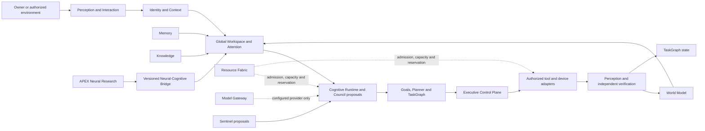

# APEX v2 canonical architecture and ownership

**Status:** canonical target architecture. This document governs design and contracts; it is not a declaration that all targets are implemented. The actual implementation map is [ARCHITECTURE.md](ARCHITECTURE.md), and the source requirements are itemized in [docs/APEX_V2_REQUIREMENTS.md](docs/APEX_V2_REQUIREMENTS.md). The v2 brief and the original Concept & Architecture document were both located and compared.

## System identity and two tracks

APEX is one persistent identity, not a model, personality, neural engine, user interface, or group of agents. Models, deterministic algorithms, tools and experimental neural components are replaceable resources. Personal state and action policy remain owned by APEX.

APEX Intelligence and APEX Neural Research evolve independently. The Bridge validates schema/version, type, range, units/timing where applicable, provenance, capability declaration and compatibility; it cannot grant memory ownership, resource allocation, or execution authority. No neural capability is inferred from a spiking implementation.

## Authority and state invariants

1–12 are preserved verbatim in meaning from v2 §12; 13–17 are T-17 additions required by the owner. Every contract, subsystem spec and test must identify the applicable invariants.

1. One persistent APEX identity across models, modes and sessions.
2. The ECP is the only authorization authority; the kill switch is outside the model path.
3. Resource Fabric is the only resource-allocation authority.
4. Memory, Knowledge, World Model, Perception and Neural Associative Memory keep distinct owners and meanings.
5. Observation, inference, assumption and prediction are always distinguishable.
6. Personas and UI themes change presentation only, never policy.
7. Emotion-inspired variables never override the ECP or create permissions.
8. Self-improvement happens only through the Evolution Lab with owner approval.
9. Experimental components never silently become trusted capabilities.
10. The UI never shows an action as done until it is verified.
11. Persistent state is recoverable and protected from unrelated destructive cleanup.
12. Evidence tiers C, P and V are preserved in all derived documents.
13. Delegation never increases authority.
14. Every consequential operation has an attributable execution chain.
15. Uncertain outcomes remain uncertain until verified.
16. Every subsystem has a defined owner and source of truth.
17. Resource consumption is bounded and observable.

**Historical T-17 enforcement-boundary wording (reviewed 2026-11-19):** `ActionRegistry` remains the registered-capability declaration source, but it is no longer accurate to describe it as the authorization authority or the ECP facade as only a future formalization. `src/executive/control-plane.js` now owns the authorization decision and delegates capability lookup to that same registry; this does not add a competing controller or policy engine. Authentication remains local process/UI-token context, not owner MFA. Startup-only per-domain autonomy is enforced by ECP; no grant or autonomy claim exceeds the code/test evidence cited in the T-30 addendum and progress report.

## Subsystem ownership register

`C/P/V` and implementation maturity are independent. “No persistent data” is intentional; a module must not invent another source of truth. Resource limits below are architectural acceptance conditions, not claims that the current machine enforces them.

| Subsystem; owner | Purpose, responsibilities and explicit non-responsibilities | Inputs → outputs; public contract | Data owner; dependencies and lifecycle | Failure, recovery and security boundary | Performance and acceptance; current evidence |
|---|---|---|---|---|---|
| Identity & Context Manager; `src/session.js`, `src/controller/context.js` | One continuing APEX identity; select relevant context. Does not authenticate an owner or grant authority. | session/config/context → bounded context, session id. | `session.json` and user-approved context stores; depends on controller/memory. | Missing pointer degrades continuity and is disclosed; no sensitive context beyond the configured scope. | Bounded turns/retrieval; restart continuity tests. V partial; Integrated. |
| Perception; current `src/documents/`, filesystem, integrations and situational sources | Owns incoming observations and their provenance. Does not promote observation to validated fact or execute embedded instructions. | text/files/system/provider inputs → typed observation/excerpts. | Each source store owns its own observations; feeds world model/reasoning. | Invalid/unavailable sources are named; untrusted content is data, never instruction; explicit roots and provider permissions. | Bounded bytes/counts; document, filesystem, provider tests. V partial; Integrated. |
| Interaction; `src/ui/`, `src/controller/` | Text UI/CLI conversation, clarification, status and controls. Not an authority source or hosted multi-user identity system. | user request → controller result, current status. | Conversation store/session; depends on controller/ECP. | Loopback token, same-origin and body bounds; transcript damage disclosed; no external resources. | Responsive, accessible, bounded; HTTP/CLI tests. V local surface; Locally validated. |
| Persona & Voice; future `interaction/persona`, `interaction/audio` | Presentation, speech input/output, barge-in, captions and selectable modes. No policy decisions or real-person voice cloning. | text/audio plus approved persona setting → presentation/speech provider request. | User-owned preferences; providers via Resource Fabric. | Provider unavailable → text/degraded state; audio data scoped and not retained without policy. | Latency/quality measured per provider; no implementation. C; Not started. |
| Global Workspace & Attention; future `cognition/workspace` | Select bounded relevant signals by task relevance, urgency, risk, novelty, uncertainty and resource cost. Salience is not truth. | typed candidate signals → bounded workspace snapshot with provenance. | No canonical store initially; input stores remain owners. | Unknown or conflicting candidate remains labeled; bounded memory/compute and deterministic refusal. | Capacity and latency benchmarks; no explicit component today. C; Not started. |
| Cognitive Runtime; `src/cognition/`, `src/reasoning/`, `src/controller/` | Request understanding, retrieval, deliberation, grounded response and proposal validation. Does not authorize or perform side effects. | request + evidence → analysis/answer/proposal. | Operation audit holds bounded diagnostics; depends on stores/gateway. | Unavailable/damaged evidence distinct from empty; model output untrusted; no inference unless enabled by owner policy. | Existing deterministic tests; inference remains disabled by current instruction. V deterministic subset; Integrated. |
| Memory; `src/memory/`, experience histories | Retained experience, episodic context, corrections and provenance. Not universally true facts or neural associations. | user/system records → history/retrieval/correction. | `memory.jsonl`, `conversation.jsonl`, `experiences.jsonl` by existing owners. | Append-only correction/supersession; private/secret boundaries; recovery preserves damage. | Bounded retrieval/retention; memory/continuity suites. V subset; Integrated. |
| Knowledge; `src/knowledge/` | Validated facts/procedures with source/lifecycle; not raw observation storage. | sourced claim → claim, conflict, correction/retraction/resolution. | `knowledge.jsonl`; depends on evidence source resolvers. | Preserve contradictions and provenance; damaged store fails closed. | Indexed/bounded search; knowledge suites. V subset; Integrated. |
| World Model; `src/world/` | User-recorded entities, state claims, relationships and events; distinguish observed/inferred/assumed/predicted. Not external truth oracle. | records/evidence refs → current/historical projection. | `world-model.jsonl`; evidence sources remain owner stores. | Conflict preserved; staleness and missing evidence explicit; no silent resolution. | Bounded query/replay; world-model/temporal suites. V subset; Integrated. |
| Neural Associative Memory; future `stark` + Bridge | Experimental candidate associations only. Not personal history, permission or validated knowledge. | neural representations → candidate association with provenance. | Neural Research owns parameters; APEX stores own authoritative records. | Bridge validation; experimental outputs isolated, replaceable and disableable. | Explicit mechanism-specific baselines; no APEX runtime. C/P research; Contract only. |
| Goals; `src/goals/` | Owner intent, criteria, constraints, priority and lifecycle. Not permission. | user goal events + evidence refs → goal projection. | `goals.jsonl`; depends on live operation evidence. | Append-only, stale references rejected; completion requires verified evidence. | bounded criteria/dependencies; goal tests. V subset; Integrated. |
| Planner; `src/plans/objective.js`, `src/planning/`, `src/plans/` | Map objectives to registered tasks, expose unknowns/constraints and propose plans. Not arbitrary intelligence or execution. | objective + live registry/goal → outline/draft. | No planning-read store; plans only through plan store. | Unmapped work stays unknown; live validity and approval hash checked. | Strict step/milestone bounds; planner tests. V bounded deterministic subset; Integrated. |
| TaskGraph / execution; `src/tasks/`, `src/controller/task-runner.js` | Explicit dependencies, checkpoints, retries, status and verified results. Does not grant authorization or parallelize implicitly. | approved task/plan → per-step execution and state. | `tasks.jsonl`, `plans.jsonl`; dependencies, audit and registry. | uncertain side effects never replayed; continuation only proven-not-started steps. | One active task-runner path, bounded steps; interruption suites. V sequential subset; Integrated. |
| Executive Control Plane; T-17 `src/executive/control-plane.js` over `src/actions/registry.js` | Sole authority for owner context, policy, capability/scope, autonomy, approval, expiry/revocation, execution permission, audit requirements and kill-switch state. Must not duplicate registry/controller or let proposals self-authorize. | trusted request context + registered capability → allow/deny/approval-required plus permission provenance. | Existing action registry remains capability source; ECP decisions attach to existing operation audit. Any policy store must be separately governed and versioned. | Fail closed on malformed policy, unknown scope, expired/revoked grant, kill switch, missing audit or unsupported level; cancel cooperative operations; only owner can change grants. | Synchronous bounded decision; adversarial tests across CLI/UI/runtime/integrations; local-only authentication limits recorded. T-17 partial; maturity/evidence in ledger. |
| Resource Fabric; T-17 `src/resources/` foundation | Sole owner of actual resource telemetry, capabilities, admission, reservations, budget, priority, cancellation and release. Must not start inference/services or race a second scheduler. | OS/provider capacity + bounded demand → telemetry and reservation decision. | No persistent allocation initially; existing runtime owns task scheduling. Per-node state is future Mesh-owned. | Unknown capacity does not become zero/unlimited; exhaustion refuses/degrades; reservations release on all exit paths. | Measure actual CPU/RAM/storage; GPU/network unknown unless a real provider reports it; budget/concurrency tests. T-17 foundation partial. |
| Model Gateway; `src/model/` | Controlled model transport/protocol, timeout/context/error/provenance. Not identity, memory, permission or resource-allocation authority. | bounded prompt + explicitly configured backend → classified unverified result. | No model output store authority; gateway contracts only. | NoBackend path; timeout/cancel/refusal/malformed states; current T-17 instruction forbids inference/network use. | Provider-specific baselines; stub tests only; Integrated, not real-world validated. |
| ECP-adjacent adapters / integration fabric; `src/integrations/`, filesystem actions | Scoped external/local connectors. Do not authorize themselves, broaden roots or retain credentials in audit. | ECP-authorized capability/config → bounded observation/action result. | Provider-owned checkpoints in integration store; workspace roots configured separately. | Allowlist, scope validation, secret redaction, retries only where safe; offline degradation. | Per-adapter budgets and external integration tests; local file provider tested. V partial; Integrated. |
| Sentinel; T-09/T-10 `src/situational/`, `src/runtime/` | Monitor authorized event sources; propose alerts/actions. Not a second planner or permission owner. | observed events → bounded/dismissible alerts and recommendations. | Situational log/runtime checkpoints; source stores remain authoritative. | Dedup, cooldown, notification budget, provider outage/dead-letter disclosure; action still through ECP. | Bounded ticks and queue; T-09/T-10 tests. V deterministic subset; Integrated. |
| Briefing Engine; `src/briefing/` (T-22 deterministic foundation; historical row called it future) | Morning/mission/incident/debrief reports from TaskGraph, World Model, memory with provenance. Does not invent current state. | bounded store snapshots → sourced briefing. | Read-only over existing stores. | Incomplete sources disclosed; no notification spam; no authority. | Historical T-17 no-implementation statement superseded by the T-22 deterministic briefing engine/API; complete external-source coverage and baselines remain unverified. C; partial. |
| Council; `src/council/` (T-25 foundation; historical row called it future) | Specialist proposals and visible disagreement, one synthesis. No model is trusted or authoritative. | independent proposals → validated synthesis and disagreement. | No separate authoritative facts; evidence references source records. | Inference remains disabled under the current instruction; ECP and resource bounds still apply. | Historical T-17 no-Council statement superseded by the T-25 service/UI foundation; no model inference or full multi-provider target is claimed. C; partial. |
| Presence Mesh; future `src/presence/` | Nodes, identity continuity, task handoff and encrypted conflict-aware sync; per-node least privilege/revocation. | signed node capability/health → scoped routing/sync. | Node-local journals and versioned sync manifests; no shared writable authority. | key revocation, replay protection, offline conflict handling, node isolation. | Network threat model and multi-device tests; no implementation. C; Not started. |
| Workshop; `src/workshop/` (T-26/T-27 deterministic foundation; historical row called it future) | Design sheets, inspection and bounded simulation. Not a shell executor or truth source. | bounded design artifact → deterministic view/simulation result. | `workshop.jsonl` through WorkshopStore; no arbitrary code execution. | Input validation, integrity checking and read-only simulation; no claim of a 3D sandbox. | Historical no-Workshop statement superseded by T-26/T-27 compose/list/inspect/simulate; holographic CAD, code execution and full simulation baselines remain absent. C; partial. |
| Evolution Lab; `src/evolution/` lifecycle foundation (T-23; historical row called it future) | Propose, sandbox, baseline-test, record, owner-approve, version and reverse changes. | change candidate + baseline → experiment record → owner promotion. | Existing lifecycle foundation; it is not a complete separate sandbox owner. | No sandboxed self-modification is claimed; ECP, scopes, kill switch and hard rules remain outside the adaptive path. | T-23 added a lifecycle foundation; T-08 adaptation is not the full lab and sandbox/baseline/rollback acceptance remains absent. C; partial. |
| Owner Authentication; future `src/identity/auth/` | Owner identity, sessions, MFA and step-up scopes. UI bearer token is not this capability. | credentials/device proof → short-lived scoped identity assurance. | Secrets provider/keychain; never plaintext audit. | rate limits, recovery, revoke sessions; fail closed for elevated scopes. | threat model and auth tests; no MFA. C; Not started. |
| Neural–Cognitive Bridge; `src/neural/` + future runtime | Versioned schema/capabilities/representation and compatibility boundary. Not neural cognition claims. | isolated runtime output → validated candidate only. | Bridge owns schemas; neural runtime owns internal parameters. | Reject invalid/late/unsupported; replaceable and disabled by default. | contract/simulation tests; no transport/runtime. C; Contract only. |
| Command Deck; `src/ui/` | Home surface reflecting actual state; not authority or source of truth. | authenticated UI reads and controller actions → panels. | All state from owner stores/services. | CSP, loopback/token, XSS-safe text, safe degraded states. | keyboard/screen-reader/responsive and state-truth tests; current interface is locally validated, visual target C. |
| Memory Timeline; future UI over `src/history/` | Scrubbable episodic/knowledge/world history with provenance. | historical read API → timeline projection. | Existing stores remain source of truth. | Historical standing and later correction separately shown; no edits from projection. | cutoff/correction test fixtures; backend history exists, UI absent. C; Integrated backend only. |
| Approval Card; future UI over ECP/controller | Explain action/why/scope/risk/undo; approve/deny/modify explicitly. | pending ECP decision → user response tied to exact bytes/scope. | Existing approval/handoff audit. | No default approve; stale hash expires; minimal visual chrome. | approval/deny/modify and replay tests; existing plan approval partial. C; Integrated backend only. |
| Tactical/System Map; future UI over integrations/dependencies | Render actual nodes/providers/files/project dependencies and data flows. | inspected graph → view. | source stores own edges; view is read-only. | no fabricated nodes/edges, scoped visibility. | graph consistency and bounded-layout tests; absent. C; Not started. |
| Overlay/HUD; future perception/UI | Spatial labels for recognized object/text/screen regions with confidence and interpretation label. | perception contract → AR/desktop overlay. | Perception owns raw observations; UI owns display only. | explicit camera permission and privacy boundary; no target treated as fact. | source/camera/evidence tests; absent. C; Not started. |
| Reliability & Recovery; `src/memory/`, stores, `src/runtime/`, `src/health.js` | Integrity, audit, checkpoint, backup, recovery and observed operational state. | component health/events → bounded diagnoses and recovery guidance. | Each subsystem's own store and audit. | preserve evidence; fail closed; no cleanup outside owned state. | corruption/restart/kill-process tests; many local suites. V partial; Locally validated. |
| Evaluation & Evolution governance; `src/evaluation/`, `src/pilot/`, `src/learning/` | Defined-baseline synthetic, integration and real-process evaluations; approved bounded adaptation. Not training or causal claims. | scenarios/outcomes → separate evaluation artifacts and owner-review candidates. | Test/pilot artifacts and existing experience records. | no inference under current instruction; keep failed/conflicting results; rollback approved changes. | baseline and protocol required; T-08/T-15/T-16 existing. V partial; Locally validated. |

## Lifecycle and cross-cutting guarantees

Every subsystem lifecycle is: construct inertly; validate declarations/input; read only its owned sources; emit typed outputs with provenance; cross authority boundaries through the ECP; record consequential effects in the existing audit chain; independently observe/verify; release resource reservations; expose health; recover from persisted records without replaying uncertain side effects. A component that cannot meet a lifecycle stage must report the limitation, not make up a successful state.

Failure policy: invalid/unknown scope, malformed policy, unavailable required owner, expired/revoked approval, resource exhaustion, timeout, cancellation or verifier failure stops, asks or degrades safely. Retriable work must be idempotent or carry an independently verified idempotency key. A resource reservation is released in `finally`; an uncertain effect is reconciled, never blindly retried.

Security policy: model/document/agent output is untrusted; owner identity is distinct from origin; capability scope is not a file-system root unless independently resolved; authorization is per consequential action; no delegation may widen scope, risk, budget or autonomy; secrets never enter reports/audit; experimental outputs cannot write authoritative stores; inference/network use is currently prohibited.

## Known architectural non-goals for T-17

Do not create a second controller, registry, planner, task store, scheduler, world model, memory, audit system or model path. Do not activate inference, download models, start an inference service, or contact a model endpoint. Do not modify the historical `stark/` track just to make its names appear integrated. Do not claim real owner MFA, multi-device mesh, GPU availability, external accounts, voice, AR or self-improvement sandboxing without implementation and evidence.

## T-19 Core state table (historical snapshot; reviewed 2026-11-19)

> Historical T-19 design record retained verbatim below. Its `Uncertain` row says there was no genuine source and reserves the state; current code has persisted uncertain task-step outcomes, so that claim is superseded by the T-30 source contract appended below. The old table is not evidence that the UI currently implements the stated precedence.

| # | State | Authoritative source | Enter conditions | Leave conditions | Precedence | Reachable |
|---|-------|----------------------|------------------|------------------|------------|-----------|
| 1 | Dormant | No runtime/process | Process not started | Process starts | lowest | no (process-level) |
| 2 | Idle | Server snapshot: no running tasks, no pending approvals, no degradation, no lockdown | No running/paused tasks, no approvals, health ok, kill-switch clear, event stream healthy | Any running task, approval, degradation, or lockdown | below awaiting/executing/degraded/lockdown | yes |
| 3 | Listening | (none) | reserved | reserved | — | reserved, not reachable (no voice pipeline) |
| 4 | Thinking | Client request in flight | Chat request submitted | Response received or failed | below lockdown/degraded | transient (UI only, derived from request) |
| 5 | Speaking | (none) | reserved | reserved | — | reserved, not reachable (no voice pipeline) |
| 6 | Executing | Task store: any task status=running | A task step is running | Task completes/pauses/fails | below lockdown/degraded | yes |
| 7 | Awaiting Approval | Task store: any step awaiting_approval or task approval flag | A step requires approval | Approval granted/rejected/cancelled | below lockdown/degraded | yes |
| 8 | Uncertain | (none with genuine source) | reserved | reserved | — | reserved, not reachable |
| 9 | Degraded | Health/event stream/kill-switch read failure | Event stream lost, heartbeat timeout, unreadable latch, health failure | Successful reconnect + reconciliation | below lockdown only | yes |
| 10 | Lockdown | ECP kill-switch latch (dataDir/kill-switch.json) | safety.lockdown activated | Explicit safety.release with reason+confirmation+audit | highest | yes |

Historical T-19 precedence claim: Lockdown > Degraded > Awaiting Approval > Executing > Thinking > Idle, with Listening, Speaking and Uncertain reserved. The T-30 current contract below adds persisted task uncertainty as a real source and priority, and reserves Dormant, Listening and Speaking instead.

## T-30 current Core-state source and precedence contract (2026-11-19)

This dated contract supersedes the historical T-19 table above where they differ. It records real source ownership, not a claim that every projection is already wired in the UI. `CORE_STATE_DEFINITIONS`, `CORE_STATE_PRECEDENCE` and the pure `resolveCoreState()` contract in `src/ui/core-state.js` are machine-checked; `tests/core-state-contract.test.js` checks them against this table, exercises overlapping-condition precedence and calls the served client setter for reserved states. The UI consumes state; it does not own or authorize it.

| State | Authoritative source and owner | Precedence (1 = highest) | Reachability at this checkpoint |
|---|---|---:|---|
| Dormant | None: a process that has not started cannot render its own state. | — | **Reserved, not reachable.** |
| Idle | Derived read of TaskStore, PlanStore, ECP kill-switch status, health and event-stream liveness; no stored `idle` flag. Underlying stores/services retain ownership. | 7 | Source is derivable; full UI precedence is pending T-30 Package 3. Never use it when a required source is unavailable. |
| Listening | None: no audio capture, wake-word or push-to-talk source exists. | — | **Reserved, not reachable.** |
| Thinking | An actual UI chat request that has been submitted and has not returned. UI request lifecycle owns this transient presentation fact only. | 6 | Reachable as presentation-only; it is not persistent system state or authorization. |
| Speaking | None: no text-to-speech source exists; voice is out of scope. | — | **Reserved, not reachable.** |
| Executing | `tasks.jsonl` through TaskStore records a task as `running`; TaskStore/TaskRunner own the transition. | 5 | Reachable from task records; UI integration remains subject to the precedence contract. |
| Awaiting Approval | `plans.jsonl` approval state or a `tasks.jsonl` step in `awaiting_approval`; PlanStore/TaskStore own lifecycle records and ECP owns authorization. | 3 | Reachable from persisted state; never hidden by Idle or ordinary activity. |
| Uncertain | `tasks.jsonl` records an uncertain step/outcome, with linked operation/verifier evidence; TaskStore owns lifecycle and the operation/verifier own their evidence. | 4 | Reachable from persisted uncertainty. The current UI does not yet map it; Package 3 must not invent completion. |
| Degraded | `collectHealth()` results and/or a failed/stale authoritative read or event-stream connection. Health is a derived projection; source owners retain their records. | 2 | Reachable. Unknown/unreadable required state maps to Degraded/Unavailable, never Idle or unlocked. |
| Lockdown | `ExecutiveControlPlane.killSwitchStatus()` rereads `dataDir/kill-switch.json`; ECP owns the latch. | 1 | Reachable from the durable latch; active Lockdown overrides every ordinary state. An unreadable latch is Degraded, not unlocked. |

Precedence is **Lockdown > Degraded > Awaiting Approval > Uncertain > Executing > Thinking > Idle**. Reserved states do not participate in precedence. A known active latch wins even if another subsystem is degraded; an unreadable latch is not treated as active=false. The UI setter maps an unknown or reserved state request to Degraded and cannot render Dormant, Listening or Speaking.

### State ownership register (T-30, 2026-11-19)

| State family | Owner and authoritative source | Read/interaction boundary |
|---|---|---|
| Task progress and outcomes | `TaskStore` (`tasks.jsonl`) and the existing TaskRunner/Controller lifecycle. | UI and event stream read/project it; neither can mark a task complete. A step is complete only after its recorded independent verification. |
| Plan lifecycle | `PlanStore` (`plans.jsonl`) and its reducer; Controller routes changes. | UI reads/project plans; it cannot create permission by displaying or animating a plan. |
| Approval | PlanStore approval events and TaskStore `awaiting_approval` step state; ECP decides whether a capability may run. | User acts through the existing Controller/ECP path. A UI token is not owner identity or approval evidence. |
| Lockdown | ECP durable `dataDir/kill-switch.json` latch. | ECP is the only owner; fail closed on unreadable/corrupt policy. The UI is a consumer and cannot release it by local display state. |
| Runtime lifecycle | `ExecutiveRuntime` and `RuntimeStateStore` (`dataDir/runtime.json`). | UI reads current status only; it does not start, resume or complete runtime work. |
| Health | `collectHealth()` is a read-only, derived health view over subsystem owners; there is no independent authoritative `health.json`. | A missing required source is unavailable/degraded, not healthy. Health display cannot repair or rewrite an owner store. |
| Autonomy configuration | `APEX_AUTONOMY_LEVELS` is parsed by `src/config.js` at startup and enforced by ECP; the displayed configuration is read-only. | Configuration is not UI-settable or live-editable; origin is not owner authentication or MFA. |
| Core, mode and connectivity display | UI (`src/ui/assets.js`) renders source state; `src/ui/server.js` owns only its HTTP/SSE transport and heartbeat. | The Core and workspace selection are projections. An SSE heartbeat proves transport liveness only; it does not establish task, policy or overall system health. |
| Resource telemetry/allocation | Resource Fabric (`src/resources/`) owns its telemetry and admission/allocation results. | The UI may display measured values; it cannot allocate resources or substitute invented values. |

The T-30 implementation evidence is deliberately narrower than the v2 target: ECP authorization, startup-only per-domain levels, a durable software kill-switch latch, runtime checkpoints and Resource Fabric foundations exist in code. Owner MFA/step-up, voice, multi-device Presence Mesh, holographic 3D Workshop, and full UI state-event reconciliation are not claimed here. Packages 2 and 3 remain responsible for their specified event and display integration.

### T-30 Package 3 correction — live projection (2026-11-19)

The pending-integration wording in the table and the preceding paragraph is retained as the Package 1 checkpoint record; it is superseded for the current T-30 state-display checkpoint by this dated correction. Package 2 completed bounded versioned owner snapshots and reconciliation. Package 3 now wires all seven snapshots (`tasks`, `plans`, `approval`, `lockdown`, `runtime`, `health`, and `conversation`) into `resolveCoreStateFromOwners()` and the served client, with **Lockdown > Degraded > Awaiting Approval > Uncertain > Executing > Thinking > Idle**. Each source is shape-validated; unavailable or malformed source data fails closed to Degraded, while a positively observed active latch still wins. Health degradation attributable only to the same recorded approval or uncertain outcome is rendered as that more-specific Core state; independent, missing, and paused-runtime conditions remain Degraded. Dormant, Listening, and Speaking remain reserved and unreachable.

The UI now starts Degraded and waits for reconciliation rather than implying Idle, reports actual `/api/state`, `/api/health`, ECP latch, and event-stream outcomes during boot, provides functioning Quick boot skip buttons, tracks a real pending chat request as Thinking, and styles the reachable states including idle breathing and contracted red Lockdown while honoring reduced-motion preference. The System view provides token/CSRF-protected Controller-to-ECP lockdown/release controls; release requires a reason (up to the existing 240-character action limit) and explicit confirmation. Audit operation ID/recorded status is surfaced, stale or changing latch state blocks release, and release does not resume paused work. ECP remains the sole authorization owner; the process-local UI token is not owner identity, MFA, or step-up authentication.

Focused and full-suite evidence, plus the browser-availability limitation, is recorded in [`reports/T30_PROGRESS.md`](reports/T30_PROGRESS.md). Browser rendering/screenshots remain unverified in this environment; this correction records local state projection and endpoint tests, not completion of the full visual v2 target.
